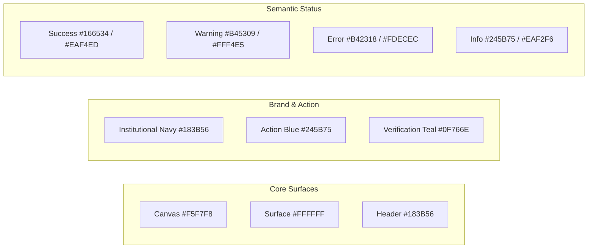

# AIRE — Design System & Visual Direction (DESIGN.md)

| Metadata     | Value                                                               |
| ------------ | ------------------------------------------------------------------- |
| Document     | `DESIGN.md` (Root Authority for Visual Direction & Anti-Slop Dials) |
| System       | UX4G-Aligned Statutory Design Direction                             |
| Status       | `APPROVED`                                                          |
| Last Updated | 3 November 2026                                                     |

---

## 1. Product Identity & Character

AIRE (AICTE Admission Reconciliation & Evidence Platform) is a statutory regulatory digital service of the Government of India.

It embodies:

- **Institutional Credibility:** Serious, authoritative, and dependable.
- **Regulatory Precision:** Exact numbers, zero fuzzy ambiguity, clear rule citations.
- **Accountability & Non-Repudiation:** Append-only event logs, tamper-evident digital digests, timestamped human sign-offs.
- **Clarity & Human Oversight:** Plain Indian English, structured administrative tables, transparent error triage.
- **Privacy Awareness:** Identity Vault isolation, purpose-bound data minimization, pseudonymous tokens.

### What AIRE Is Not

- **Not an AI Startup Dashboard:** No dark neon gradients, no glowing cards, no floating blur spheres, no decorative charts without data.
- **Not a Generic SaaS Template:** No pill-shaped inputs, no oversized hero graphics in operational workspaces, no generic marketing buzzwords ("revolutionize", "seamless", "unlock").

---

## 2. Anti-Slop Dials

Under the Anti-Slop framework, AIRE calibrates its visual dials as follows:

| Dial       | Calibration                        | Purpose & Implementation                                                                                                                                                                                                        |
| ---------- | ---------------------------------- | ------------------------------------------------------------------------------------------------------------------------------------------------------------------------------------------------------------------------------- |
| **ENERGY** | **Calm & Confident**               | Visual energy is reserved exclusively for meaningful actions (e.g. Irreversible Cohort Seal) and critical status changes (Quarantine Errors, Show Cause Notices). Normal browsing is grounded in clean surfaces and crisp text. |
| **RHYTHM** | **Structured Operational Density** | A deliberate balance between dense operational tabular data (36px rows for cohorts of 500+ records) and spacious, unhurried breathing room around destructive regulatory decisions.                                             |
| **MOTION** | **Functional & Minimal**           | Transitions communicate state changes only (drawer opening, accordion expansion, modal entry, validation spinner). All transitions strictly respect `prefers-reduced-motion: reduce`. Decorative animations are prohibited.     |

---

## 3. Canonical Color Palette (Reconciled Authority)

All color tokens adhere to WCAG 2.2 Level AA contrast requirements ($\ge 4.5:1$ for normal text, $\ge 3:1$ for large text and UI boundaries).

| Role                      | Hex Value             | Purpose                                                      | Contrast vs White / Surface |
| ------------------------- | --------------------- | ------------------------------------------------------------ | --------------------------- |
| **Institutional Navy**    | `#183B56`             | Header surface, primary branding, institutional hierarchy    | $11.7:1$ (AAA)              |
| **Action Blue**           | `#245B75`             | Primary buttons, active links, interactive triggers          | $7.5:1$ (AAA)               |
| **Verification Teal**     | `#0F766E`             | Credential tokens, verified status badges, focus ring accent | $5.5:1$ (AA)                |
| **Canvas**                | `#F5F7F8`             | Global application background                                | -                           |
| **Surface**               | `#FFFFFF`             | Card surfaces, modals, table backgrounds                     | -                           |
| **Primary Text**          | `#172B3A`             | Body text, headings, table values                            | $13.9:1$ (AAA)              |
| **Secondary Text**        | `#526579`             | Supporting descriptions, column headers                      | $5.8:1$ (AA)                |
| **Border Default**        | `#D8E0E7`             | Card edges, form input borders, table separators             | $3.2:1$ (AA non-text)       |
| **Success Text / Bg**     | `#166534` / `#EAF4ED` | Approved cohorts, verified seats, valid records              | $6.3:1$ (AA)                |
| **Warning Text / Bg**     | `#B45309` / `#FFF4E5` | Pending deadlines, quota nearing capacity, warnings          | $4.5:1$ (AA)                |
| **Error Text / Bg**       | `#B42318` / `#FDECEC` | Quarantined records, intake violations, 403 errors           | $5.9:1$ (AA)                |
| **Information Text / Bg** | `#245B75` / `#EAF2F6` | Informational callouts, guideline references                 | $6.6:1$ (AA)                |
| **Focus Ring**            | `#245B75`             | Visible keyboard focus indicator (2px offset)                | $7.5:1$ (AA non-text)       |

---

## 4. Typography Foundations

- **Primary Typeface:** Noto Sans / Inter, with fallbacks `-apple-system, BlinkMacSystemFont, 'Segoe UI', Roboto, Helvetica, Arial, sans-serif`.
- **Tabular Numerals (`font-tabular`):** Enabled for all regulatory numbers, roll numbers, intake quotas, dates, and cryptographic digests (`font-variant-numeric: tabular-nums`).
- **Scale:**
  - `Display / H1`: 24px (1.5rem), semi-bold (`font-bold`), line-height 1.25.
  - `Headline / H2`: 18px (1.125rem), semi-bold (`font-semibold`), line-height 1.35.
  - `Section / H3`: 14px (0.875rem), semi-bold (`font-semibold`), line-height 1.4.
  - `Body / Normal`: 13px (0.8125rem), regular (`font-normal`), line-height 1.5.
  - `Caption / Metadata`: 11px (0.6875rem), medium (`font-medium`), line-height 1.4.

---

## 5. Layout, Grids & Breakpoints

- **Mobile First:** Designed from 320px upwards.
- **Breakpoints:**
  - `sm`: 640px
  - `md`: 768px (Sidebar transitions to collapsible drawer)
  - `lg`: 1024px (Multi-column workbenches enabled)
  - `xl`: 1280px (Standard wide desktop)
  - `2xl`: 1536px (High-resolution administrative displays)
- **Component Geometry:**
  - Primary button height: 36px (`h-9`), rounded 4px (`rounded-md`).
  - Input field height: 36px (`h-9`), padding 8px 12px.
  - Compact table row: 36px (`h-9`).
  - Standard table row: 44px (`h-11`).
  - Border radius standard: 4px (`0.25rem` / `rounded`). Zero pill buttons on rectangular cards.
