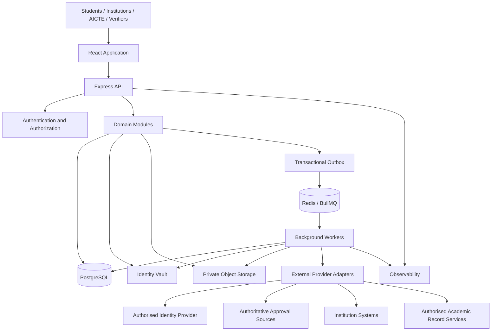
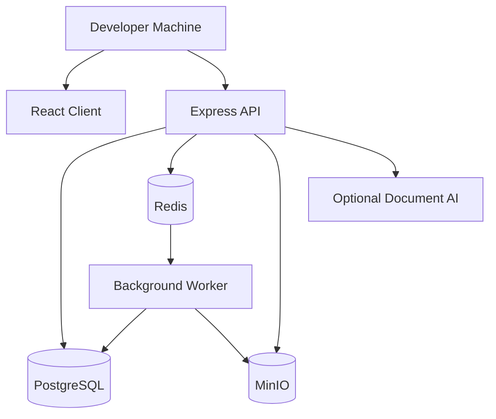
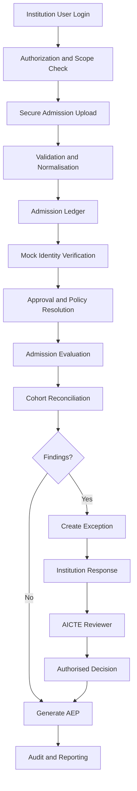

# AIRE — Master Project Plan

**AICTE Admission Reconciliation & Evidence Platform**

> The authoritative product, architecture, engineering, security, privacy, implementation and delivery blueprint for AIRE.

| Document metadata            | Value                                                     |
| ---------------------------- | --------------------------------------------------------- |
| Document                     | `PROJECT_PLAN.md`                                         |
| Project                      | AIRE                                                      |
| Full form                    | AICTE Admission Reconciliation & Evidence Platform        |
| Project type                 | Regulatory admission reconciliation and evidence platform |
| Document status              | Master baseline — proposed                                |
| Version                      | 1.0                                                       |
| Last updated                 | 30 October 2026                                           |
| Primary architecture         | Modular monolith                                          |
| Frontend                     | React + TypeScript                                        |
| Backend                      | Node.js + Express + TypeScript                            |
| Database                     | PostgreSQL + Prisma                                       |
| Background processing        | Redis + BullMQ                                            |
| Optional document AI service | Python + FastAPI                                          |
| Deployment                   | Docker-based infrastructure                               |

---

# 0. DOCUMENT CONTROL AND USAGE

## 0.1 Purpose

This document defines the complete plan for designing, building, testing, securing and demonstrating AIRE.

It is the top-level reference for:

- Product vision and problem definition.
- Existing-system integration and product boundaries.
- Functional and non-functional requirements.
- User types, permissions and scopes.
- Privacy-by-design and security architecture.
- Application, backend and database architecture.
- Module specifications and implementation dependencies.
- Database entities and data lifecycle.
- API contracts and integration architecture.
- Admission reconciliation and regulatory rule evaluation.
- Evidence management and human review.
- DevOps, deployment and observability.
- Testing, quality assurance and security verification.
- Implementation phases, milestones and acceptance criteria.
- Demonstration, evaluation and future deployment readiness.

## 0.2 How to use this document

This file is the master index, not a replacement for detailed module specifications.

Every major domain must have its own detailed document. The master plan links to these documents using relative Markdown paths.

**Documentation rule:** When a technical implementation decision changes, update the relevant lower-level specification and then update this master plan if the change affects architecture, scope, dependencies or project commitments.

## 0.3 Documentation status convention

| Status        | Meaning                                            |
| ------------- | -------------------------------------------------- |
| `PLANNED`     | Document or feature is planned but not implemented |
| `DRAFT`       | Initial specification exists                       |
| `REVIEW`      | Awaiting technical or domain review                |
| `APPROVED`    | Reviewed and accepted baseline                     |
| `IN_PROGRESS` | Implementation underway                            |
| `IMPLEMENTED` | Code has been completed                            |
| `VERIFIED`    | Acceptance tests have passed                       |
| `BLOCKED`     | Depends on unresolved external input               |

Never mark a feature as implemented merely because its UI or mock workflow exists.

---

# 1. MASTER INDEX

## 1.1 Project overview

- [01 — Product Vision and Problem Definition](#2-product-vision-and-problem-definition)
- [02 — Existing Ecosystem and Research](#3-existing-ecosystem-and-research)
- [03 — Product Scope and Boundaries](#4-product-scope-and-boundaries)
- [04 — Stakeholders, Users and Authorization](#5-stakeholders-users-and-authorization)
- [05 — Functional Requirements](#6-functional-requirements)
- [06 — Non-Functional Requirements](#7-non-functional-requirements)

## 1.2 Technical architecture

- [07 — System Architecture](#8-system-architecture)
- [08 — Technology Stack](#9-technology-stack)
- [09 — Application Architecture](#10-application-architecture)
- [10 — Backend Architecture](#11-backend-architecture)
- [11 — Database Architecture](#12-database-architecture)
- [12 — API Architecture](#13-api-architecture)
- [13 — Integration Architecture](#14-integration-architecture)

## 1.3 Security and privacy

- [14 — Privacy by Design](#15-privacy-by-design)
- [15 — Authentication and Authorization](#16-authentication-and-authorization)
- [16 — Database Security and Tenant Isolation](#17-database-security-and-tenant-isolation)
- [17 — Identity Vault and Sensitive Data](#18-identity-vault-and-sensitive-data)
- [18 — Audit, Governance and Retention](#19-audit-governance-and-retention)

## 1.4 Product modules

- [M01 — Identity and Access Management](#20-m01--identity-authentication-and-access-management)
- [M02 — Institution and Programme Registry](#21-m02--institution-and-programme-registry)
- [M03 — Approval and Seat Entitlement Registry](#22-m03--approval-and-seat-entitlement-registry)
- [M04 — Regulatory Policy and Rule Registry](#23-m04--regulatory-policy-and-rule-registry)
- [M05 — Institution Onboarding and Admission Submission](#24-m05--institution-onboarding-and-admission-submission)
- [M06 — Data Ingestion and Normalisation](#25-m06--data-ingestion-and-normalisation)
- [M07 — APAAR Identity Verification Gateway](#26-m07--apaar-identity-verification-gateway)
- [M08 — Admission Lifecycle and Record Ledger](#27-m08--admission-lifecycle-and-record-ledger)
- [M09 — Admission Entitlement Engine](#28-m09--admission-entitlement-engine)
- [M10 — Cohort Reconciliation Engine](#29-m10--cohort-reconciliation-engine)
- [M11 — Exception and Human Review Workbench](#30-m11--exception-and-human-review-workbench)
- [M12 — Verifiable Student Records](#31-m12--verifiable-student-records-and-certificate-integration)
- [M13 — Dashboards and Reporting](#32-m13--dashboards-reports-and-analytics)
- [M14 — Integration Hub](#33-m14--integration-hub)
- [M15 — Privacy, Security and Governance](#34-m15--privacy-security-and-governance)

## 1.5 Engineering and delivery

- [20 — Repository and Documentation Structure](#35-repository-and-documentation-structure)
- [21 — Development Standards](#36-development-standards)
- [22 — Testing Strategy](#37-testing-and-quality-assurance)
- [23 — DevOps and Deployment](#38-devops-and-deployment)
- [24 — Observability and Operations](#39-observability-and-operations)
- [25 — Implementation Roadmap](#40-implementation-roadmap)
- [26 — Vertical Slice](#41-first-end-to-end-vertical-slice)
- [27 — Acceptance Criteria](#42-project-wide-acceptance-criteria)
- [28 — Risks and Dependencies](#43-risks-dependencies-and-mitigation)
- [29 — Research and Reference Index](#44-research-and-reference-index)

---

# 2. PRODUCT VISION AND PROBLEM DEFINITION

## 2.1 Product identity

**AIRE — AICTE Admission Reconciliation & Evidence Platform**

AIRE is a regulatory admission reconciliation and evidence platform intended to connect institution-reported admission information with authoritative approval information, applicable regulatory rules, admission lifecycle events and authorised identity evidence.

It produces structured, reproducible and evidence-backed evaluations that authorised reviewers can investigate and resolve.

## 2.2 Core product statement

AIRE provides an evidence-driven workflow for reconciling admission records against applicable institutional approvals and regulatory requirements, identifying inconsistencies, preserving the evidence behind every evaluation and supporting authorised human review.

## 2.3 The problem AIRE addresses

The problem should be understood as a combination of information reconciliation, regulatory evaluation, institutional reporting and evidence management.

The system must support the following questions:

1. Is the submitted admission record associated with the correct institution, campus and programme?
2. Is there an applicable approval record for the programme and academic year?
3. What approved intake and category entitlements apply?
4. Is the admission consistent with the applicable regulatory conditions?
5. Has the student's academic identity been verified through an authorised source?
6. Are there potential duplicate, conflicting or concurrent admission records?
7. Have corrections, cancellations, transfers and withdrawals been represented accurately?
8. Can the result be traced to the exact evidence, policy and approval versions used?
9. Can authorised institution personnel respond to findings?
10. Can authorised AICTE personnel review and record decisions?

## 2.4 Product differentiators

### A. Admission Entitlement Proof (AEP)

Every evaluated admission can have a structured evidence artefact containing:

- Admission reference.
- Institution and programme references.
- Applicable approval version.
- Applicable policy version.
- Academic year.
- Relevant admission lifecycle snapshot.
- Identity verification state and evidence reference.
- Evaluation engine version.
- Input snapshot hash.
- Rule-by-rule evaluation trace.
- Findings and missing evidence.
- Review status and authorised decision references.

AEP is an internal evidence artefact. It is not an AICTE certificate, legal compliance certificate or independent proof that an admission is legally valid.

### B. Regulatory Replay and Impact Analysis

When an approval or regulatory policy changes, AIRE can identify affected records and perform a controlled re-evaluation.

It must:

- Preserve previous evaluations.
- Record the newly applicable version.
- Respect the legal effective date.
- Distinguish retrospective correction from prospective rule changes.
- Explain why an evaluation changed.
- Never silently overwrite an earlier decision.

### C. Policy-aware identity resolution

The system must distinguish:

- Duplicate uploads.
- Repeated admission records.
- Possible identity conflicts.
- Transfers and withdrawals.
- Potentially permitted simultaneous academic programmes.
- Inconclusive identity matches.

A shared APAAR reference does not automatically indicate fraud or an invalid admission.

### D. Evidence-based exception resolution

Every exception should provide:

- The specific finding.
- The source record.
- The applicable approval and rule.
- Relevant inputs.
- Calculation trace, where applicable.
- Missing or conflicting evidence.
- Institution response.
- Reviewer activity.
- Final authorised disposition.

### E. Admission lifecycle chronology

The platform preserves the history of admission-related changes rather than overwriting records.

Every event should distinguish:

- `effective_at`: when the event reportedly happened.
- `recorded_at`: when AIRE received it.

The system must support correction history and traceable state transitions.

## 2.5 Product success criteria

AIRE should be evaluated on:

- Accuracy of deterministic regulatory evaluation.
- Reproducibility of historical evaluations.
- Detection quality and false-positive rate.
- Correct handling of missing and conflicting evidence.
- Reduction in manual reconciliation effort.
- Time required to resolve an exception.
- Tenant-isolation effectiveness.
- Privacy and security control effectiveness.
- Traceability of every result.
- Integration readiness.

---

# 3. EXISTING ECOSYSTEM AND RESEARCH

AIRE must integrate with the existing academic and regulatory ecosystem rather than duplicate it.

## 3.1 APAAR

APAAR is the persistent academic identity framework.

AIRE must not create another national academic identity.

Expected role:

- Use authorised identity references.
- Support identity verification through approved integration mechanisms.
- Associate verification evidence with admission evaluations.
- Keep raw identity information in a protected data domain.

Reference: https://apaar.education.gov.in/faqs

## 3.2 Academic Bank of Credits

ABC manages academic credit-related records and workflows.

AIRE must not recreate an academic credit wallet.

Reference: https://directory.apisetu.gov.in/api-collection/abc

## 3.3 DigiLocker and NAD

DigiLocker/NAD provides access to digitally issued academic awards and verification functionality.

AIRE should integrate only where an authorised use case and provider interface exist.

Reference: https://nad.digilocker.gov.in/Verifier

## 3.4 AISHE

AISHE collects higher-education institution information, including aggregate enrolment and other institutional statistics.

Published forms should be examined carefully before attempting aggregate reconciliation.

AIRE must not assume that AISHE aggregate figures are equivalent to individual admission records.

Reference: https://aishe.gov.in/web-dcf/

## 3.5 AICTE approval information

AICTE approval records and applicable approval orders are essential inputs to AIRE.

The platform must preserve:

- Source document.
- Approval order reference.
- Institution identity.
- Programme and campus association.
- Effective academic year.
- Intake and entitlement information.
- Amendments and superseding orders.
- Source version and integrity checksum.

Primary reference: https://www.aicte.gov.in/sites/default/files/APH%20Final.pdf

The applicable approval handbook, amendments and circulars must be revalidated for the actual academic year being evaluated.

## 3.6 Existing-system and gap analysis

AIRE must not claim that AICTE has no student-level enrolment functionality.

The existing approval handbook describes student-enrolment upload requirements for at least specified categories of institutions and programmes.

The actual problem statement's operational gap, existing backend coverage and intended integration requirements must be confirmed with AICTE.

## 3.7 Competitive and prototype analysis

Public prototypes already demonstrate common concepts such as:

- APAAR matching.
- Duplicate detection.
- Admission uploads.
- Seat validation.
- Exception queues.
- Institutional dashboards.
- Audit trails.

Therefore, a generic combination of these features should not be presented as a novel breakthrough.

AIRE's implementation should focus on:

- Versioned regulatory applicability.
- Reproducible evaluation.
- Evidence provenance.
- Admission chronology.
- Policy-aware identity resolution.
- Privacy-preserving data access.
- Database-enforced tenant isolation.
- Human-authorised exception resolution.

Public examples for research:

- https://github.com/soumya-vinod/apaar-integrity-platform
- https://github.com/vinay2905-lang/SIH-2K26-2

These repositories are research references, not verified production implementations or confirmed competitors.

---

# 4. PRODUCT SCOPE AND BOUNDARIES

## 4.1 In scope

- Institution and campus registry.
- Programme registry.
- Approval and entitlement versioning.
- Regulatory policy versioning.
- Institutional onboarding.
- Admission data ingestion.
- Admission lifecycle tracking.
- Authorised APAAR verification.
- Identity conflict detection.
- Deterministic entitlement evaluation.
- Cohort reconciliation.
- Exception management.
- Evidence management.
- Human review and decisions.
- Admission evidence proofs.
- Authorised reporting.
- Privacy and governance.
- External verification workflows where authorised.

## 4.2 Out of scope

AIRE is not:

- A replacement for APAAR.
- A replacement for ABC.
- A national academic identity provider.
- A digital academic credit wallet.
- A certificate repository.
- A college ERP.
- A learning management system.
- An admission application portal.
- An automated student rejection engine.
- An automated fraud verdict engine.
- A platform for independently changing AICTE approvals.
- A blockchain-based student registry by default.

## 4.3 AI boundaries

AI may assist with:

- Document extraction.
- Candidate field mapping.
- Unstructured evidence classification.
- Candidate entity matching.
- Reviewer assistance.
- Natural-language explanation of deterministic findings.

AI must not independently:

- Establish regulatory policy.
- Activate policy rules.
- Calculate legal entitlements using unverified assumptions.
- Issue final regulatory decisions.
- Declare a student fraudulent.
- Reject an admission.
- Modify authoritative approval records.

**Deterministic code performs regulatory calculations. Authorised humans govern regulatory policy and final decisions.**

---

# 5. STAKEHOLDERS, USERS AND AUTHORIZATION

## 5.1 User types

| User code                        | Role                           | Primary responsibility                      |
| -------------------------------- | ------------------------------ | ------------------------------------------- |
| `AIRE_SUPER_ADMIN`               | AICTE Super Administrator      | Platform-level governance                   |
| `AICTE_ADMIN`                    | AICTE Administrator            | Regulatory and institutional administration |
| `AICTE_REVIEWER`                 | AICTE Reviewer                 | Reconciliation and exception review         |
| `INSTITUTION_ADMIN`              | Institution Administrator      | Institution configuration and membership    |
| `INSTITUTION_DATA_OPERATOR`      | Institution Data Operator      | Admission uploads and corrections           |
| `INSTITUTION_COMPLIANCE_OFFICER` | Institution Compliance Officer | Evidence and institutional responses        |
| `STUDENT`                        | Student                        | Own-record access and correction requests   |
| `EXTERNAL_VERIFIER`              | External Verifier              | Specific authorised verification requests   |
| `AUDITOR`                        | Auditor                        | Read-only authorised audit access           |

Detailed specification: `docs/03-user-management/USER_ROLES_AND_SCOPES.md`

## 5.2 Authorization model

AIRE must use:

- Role-Based Access Control (RBAC).
- Attribute-Based Access Control (ABAC).
- Scope-based authorization.
- Purpose-based authorization.
- Field-level authorization.
- Assignment-based authorization.

## 5.3 Scope hierarchy

```text
PLATFORM
  └── REGULATORY / WORKLOAD
       └── INSTITUTION
            └── CAMPUS
                 └── PROGRAMME
                      └── ACADEMIC_YEAR
                           └── COHORT
                                └── RECORD
                                     └── VERIFICATION_REQUEST
```

This is a logical authorization hierarchy, not a requirement that every user's access be a strict parent-child tree.

Users may have multiple independent scope assignments.

## 5.4 Authorization decision sequence

Every protected request must pass:

1. Valid authentication.
2. Active user status.
3. Active membership.
4. Required permission.
5. Resource scope match.
6. Assignment check, if required.
7. Processing-purpose authorization.
8. Data classification and field access.
9. Additional approval or step-up authentication, if required.

Default decision: DENY.

## 5.5 Separation of duties

- Institution data operators cannot approve their own regulatory submissions.
- Institution personnel cannot resolve their own regulatory exceptions as AICTE reviewers.
- Institution administrators cannot create AICTE privileged accounts.
- Policy authors cannot activate their own high-impact policy changes without the required independent approval.
- Sensitive identity access requires separate permission.
- Privileged operations must be audited.

---

# 6. FUNCTIONAL REQUIREMENTS

## 6.1 Institution management

- Register and maintain authorised institutions.
- Maintain campuses and programme associations.
- Manage institution memberships.
- Assign scoped permissions.
- Support institution status and verification.
- Prevent unauthorised cross-institution access.

## 6.2 Approval management

- Import authoritative approval information.
- Preserve approval documents.
- Version approval records.
- Support amendments and superseding orders.
- Track effective periods.
- Associate programme-specific entitlement data.
- Flag missing or conflicting approval evidence.

## 6.3 Policy management

- Maintain source documents.
- Create versioned policy packs.
- Associate rules with applicable academic years and dates.
- Define required evidence.
- Run rule test fixtures.
- Require human review before activation.
- Preserve historical policy versions.

## 6.4 Admission management

- Upload admission records.
- Validate and normalise data.
- Associate students with institution and programme.
- Preserve admission chronology.
- Support corrections and cancellation events.
- Track submission provenance.

## 6.5 Identity verification

- Use an adapter-based provider architecture.
- Support mock, authorised sandbox and production modes.
- Track identity verification status.
- Preserve verification references.
- Protect raw identity data.
- Handle provider unavailability separately from failed verification.

## 6.6 Reconciliation

- Select applicable approval versions.
- Select applicable policy versions.
- Evaluate admissions.
- Identify inconsistencies.
- Produce traceable findings.
- Generate AEP records.
- Support historical replay.
- Produce cohort-level results.

## 6.7 Exception management

- Create exceptions.
- Assign reviewers.
- Request evidence.
- Accept institutional responses.
- Preserve reviewer notes.
- Record authorised decisions.
- Track exception state transitions.

## 6.8 Reporting

- Institution-level dashboards.
- AICTE-level dashboards.
- Submission quality reports.
- Reconciliation results.
- Exception status.
- Aggregate reporting.
- Controlled exports.
- Privacy-safe analytics.

Detailed requirements: `docs/02-product/REQUIREMENTS.md`

---

# 7. NON-FUNCTIONAL REQUIREMENTS

| Category         | Requirement                                                       |
| ---------------- | ----------------------------------------------------------------- |
| Security         | Defence-in-depth and least privilege                              |
| Privacy          | Privacy by design and default                                     |
| Isolation        | Database-enforced tenant isolation                                |
| Availability     | Defined service availability target before production             |
| Reliability      | Idempotent processing and recoverable jobs                        |
| Performance      | Measured response and processing targets                          |
| Scalability      | Horizontal worker scaling                                         |
| Integrity        | Immutable evaluation references and traceable events              |
| Maintainability  | Modular architecture and clear domain boundaries                  |
| Accessibility    | WCAG 2.2 AA target, subject to applicable government requirements |
| Interoperability | Versioned APIs and provider adapters                              |
| Auditability     | Traceable sensitive actions and decisions                         |
| Reproducibility  | Same versioned inputs produce reproducible evaluation results     |
| Recoverability   | Tested backup and restoration procedures                          |

Performance and availability targets must be established through workload assumptions and load testing rather than invented upfront.

---

# 8. SYSTEM ARCHITECTURE

## 8.1 Architectural approach

Use a **modular monolith with independently scalable background workers**.

Do not begin with microservices.

A modular monolith provides:

- Strong module boundaries.
- Simpler transactions.
- Easier development and deployment.
- Lower infrastructure complexity.
- Easier end-to-end testing.
- A future path to extract independent services where justified.

## 8.2 High-level architecture



## 8.3 Core architectural rules

1. PostgreSQL is the authoritative application data store.
2. Redis is a queue/cache system, not a business source of truth.
3. All regulatory calculations are deterministic.
4. Provider integrations are isolated behind adapters.
5. All tenant-sensitive queries execute through secure database transactions.
6. All sensitive data access is purpose-bound and auditable.
7. No frontend-to-provider privileged integration.
8. No direct database access from the frontend.
9. No silent modification of historical decisions.
10. All background jobs are idempotent and scoped.

Detailed specification: `docs/01-architecture/SYSTEM_ARCHITECTURE.md`

---

# 9. TECHNOLOGY STACK

## 9.1 Frontend

| Technology      | Responsibility                  |
| --------------- | ------------------------------- |
| React           | UI framework                    |
| TypeScript      | Type safety                     |
| Vite            | Development and build tooling   |
| Tailwind CSS    | Styling                         |
| React Router    | Navigation                      |
| TanStack Query  | Server-state management         |
| React Hook Form | Form handling                   |
| Zod             | Input validation                |
| Zustand         | Limited client-state management |
| Chart.js        | Dashboards and charts           |

Use a consistent component library and design system.

## 9.2 Backend

| Technology     | Responsibility                                        |
| -------------- | ----------------------------------------------------- |
| Node.js 24 LTS | Runtime baseline, subject to deployment compatibility |
| Express        | HTTP API                                              |
| TypeScript     | Application language                                  |
| Prisma 7       | Database ORM                                          |
| PostgreSQL     | Primary database                                      |
| Redis          | Queue and cache infrastructure                        |
| BullMQ         | Background jobs                                       |
| Zod            | Runtime validation                                    |
| OpenAPI        | API documentation                                     |
| Pino           | Structured logging                                    |

## 9.3 AI and document processing

Optional Python service:

| Technology      | Responsibility                  |
| --------------- | ------------------------------- |
| Python          | Document-processing runtime     |
| FastAPI         | Internal processing API         |
| OCR engine      | Text extraction                 |
| Document parser | PDF and document extraction     |
| LLM adapter     | Controlled candidate extraction |
| Pydantic        | Output schema validation        |

The Python service is optional and must not own admission policy decisions.

## 9.4 Infrastructure

- Docker.
- Docker Compose for development.
- Nginx reverse proxy.
- PostgreSQL.
- Redis.
- S3-compatible private object storage.
- MinIO for local development.
- GitHub Actions.
- KMS/secret-management integration.
- OpenTelemetry.
- Prometheus and Grafana where justified.

Detailed specification: `docs/01-architecture/TECH_STACK_AND_DECISIONS.md`

---

# 10. APPLICATION ARCHITECTURE

## 10.1 Application areas

The application should expose role-appropriate workspaces rather than one generic dashboard.

### AICTE workspace

- Regulatory overview.
- Institution registry.
- Approval registry.
- Policy registry.
- Reconciliation monitoring.
- Exception review.
- Reports.
- Audit and governance.

### Institution workspace

- Institution overview.
- Campus and programme details.
- Admission submissions.
- Upload validation.
- Reconciliation results.
- Exceptions.
- Institutional responses.
- User management.

### Student workspace

- Own record.
- Permitted identity verification status.
- Correction requests.
- Permitted verification references.

### External verifier workspace

- Verification request creation.
- Verification result.
- Request history within authorised scope.

### Auditor workspace

- Approved audit records.
- Historical evaluations.
- Evidence references.
- Access history.

## 10.2 Frontend security requirements

- Navigation visibility must follow permissions.
- Hidden navigation is not an authorization mechanism.
- API requests must be independently authorized.
- Sensitive fields must be masked by default.
- No sensitive records in local storage.
- No raw identity information in browser logs.
- Exports must have explicit permission and purpose.
- Session expiry must clear sensitive client state.
- Prevent stale cached data from being displayed after scope changes.
- Enforce accessible and understandable privacy notices.

## 10.3 Design principles

- Professional regulatory interface.
- Clear data hierarchy.
- Consistent status language.
- Evidence-first workflows.
- Transparent error states.
- Accessible contrast and typography.
- Clear distinction between automated findings and human decisions.
- No visual implication that an AI-generated result is an official legal verdict.

Detailed specification: `docs/04-frontend/FRONTEND_ARCHITECTURE.md`

---

# 11. BACKEND ARCHITECTURE

## 11.1 Domain-driven module boundaries

Each module should contain:

```text
module-name/
├── module.routes.ts
├── module.controller.ts
├── module.service.ts
├── module.repository.ts
├── module.schema.ts
├── module.policy.ts
├── module.dto.ts
├── module.types.ts
├── module.events.ts
├── module.errors.ts
└── tests/
```

Not every module needs every file. The structure should follow actual complexity.

## 11.2 Layer responsibilities

### Routes

- Define endpoints.
- Attach authentication.
- Attach request-level middleware.
- Connect controller handlers.

### Controllers

- Parse request.
- Call application service.
- Return standard response.
- Do not contain business rules.

### Services

- Implement use cases.
- Enforce workflow transitions.
- Coordinate domain operations.
- Invoke authorization decisions.

### Repositories

- Encapsulate persistence.
- Execute tenant-scoped transactions.
- Apply database constraints.
- Avoid exposing unrestricted database access.

### Policies

- Define action-level and resource-level authorization requirements.
- Must not be duplicated inconsistently across controllers.

### DTOs

- Define permitted request and response fields.
- Prevent accidental exposure of database models.

## 11.3 Standard API response

```json
{
  "data": {},
  "error": null
}
```

Error response:

```json
{
  "data": null,
  "error": {
    "code": "PERMISSION_DENIED",
    "message": "You are not authorised to perform this operation.",
    "correlationId": "COR-12345"
  }
}
```

Never include stack traces, SQL errors, raw provider responses or sensitive identifiers in public error messages.

## 11.4 Event-driven processing

Use the transactional outbox pattern.

1. Write the business change.
2. Write the corresponding outbox event in the same database transaction.
3. Publish the outbox event to BullMQ.
4. Process it with an idempotent worker.
5. Record processing state.
6. Retry transient failures with bounded backoff.
7. Send exhausted jobs to a dead-letter workflow.
8. Allow authorised recovery.

Detailed specification: `docs/01-architecture/BACKEND_ARCHITECTURE.md`

---

# 12. DATABASE ARCHITECTURE

## 12.1 Database principles

- PostgreSQL is the source of truth.
- Use relational structures for important domain entities.
- Avoid large all-in-one JSON records.
- Use explicit tenant ownership.
- Enforce relationships through foreign keys.
- Use append-only event history where appropriate.
- Preserve approval, policy and evaluation versions.
- Use transaction boundaries deliberately.
- Use database constraints to enforce invariants.
- Apply RLS to tenant-owned data.
- Separate highly restricted identity information.

## 12.2 Domain schemas

Organise the database logically into:

```text
identity
access_control
registry
approvals
policy
submissions
admissions
identity_vault
reconciliation
exceptions
evidence
verification
integrations
privacy
audit
operations
```

These can initially be PostgreSQL schemas or a logical naming convention. Do not introduce multiple databases without a demonstrated need.

## 12.3 Main entity groups

### Identity and access

- users
- roles
- permissions
- role_permissions
- memberships
- membership_scopes
- reviewer_assignments
- sessions
- delegations

### Registry

- institutions
- campuses
- programmes
- institution_aliases
- programme_aliases

### Approval

- approval_orders
- approval_versions
- programme_entitlements
- approval_documents

### Policy

- policy_sources
- policy_packs
- policy_rules
- policy_activations
- policy_test_cases

### Submissions

- submission_batches
- submission_rows
- submission_mappings
- submission_validation_results

### Admissions

- admissions
- admission_events
- admission_snapshots

### Identity vault

- student_identity_refs
- identity_checks
- identity_provider_responses

### Reconciliation

- reconciliation_runs
- rule_evaluations
- admission_proofs
- reconciliation_findings

### Exceptions

- exceptions
- exception_findings
- exception_assignments
- institution_responses
- review_decisions

### Evidence

- evidence_documents
- evidence_links
- evidence_access_events

### Verification

- verifiable_records
- verification_requests
- revocation_records

### Privacy and governance

- processing_purposes
- purpose_permissions
- data_classifications
- retention_policies
- legal_holds
- consent_records
- data_subject_requests
- deletion_jobs

### Audit and operations

- audit_events
- access_audit_events
- security_events
- outbox_events
- integration_jobs
- processing_tasks
- webhook_events

## 12.4 Tenant ownership

Every institution-owned record must have an enforceable institution relationship.

Use composite foreign keys where necessary to prevent cross-tenant associations.

## 12.5 Row-Level Security

Enable RLS on tenant-owned tables.

Use:

- `ENABLE ROW LEVEL SECURITY`.
- `FORCE ROW LEVEL SECURITY`.
- Explicit policies.
- Least-privilege runtime credentials.
- Separate migration credentials.
- Transaction-local context.
- Assignment-aware reviewer access.

The runtime role must not own tenant tables or have `BYPASSRLS`.

Custom PostgreSQL settings are context carriers, not cryptographic identity. The backend must establish trusted context after authorization, and database credentials must remain tightly restricted.

## 12.6 Sensitive data separation

Raw APAAR identifiers must not be stored in ordinary admission tables.

Use a separate identity vault with:

- Envelope encryption.
- KMS-managed keys.
- Key version tracking.
- Key rotation.
- Restricted decryption.
- HMAC-based matching tokens.
- Separate audit events.
- No raw identifier in ordinary logs.

## 12.7 Event history

Admission events should preserve:

- Event type.
- Effective time.
- Recorded time.
- Actor.
- Source batch.
- Evidence references.
- Correction reference.
- Before/after values where appropriate.

The current admission projection is derived from the event history and controlled updates.

Detailed specifications:

- `docs/05-database/DATABASE_DESIGN.md`
- `docs/05-database/ENTITY_RELATIONSHIP_MODEL.md`
- `docs/05-database/RLS_AND_TENANT_ISOLATION.md`
- `docs/05-database/DATA_MIGRATION_STRATEGY.md`

---

# 13. API ARCHITECTURE

## 13.1 API conventions

Base path:

`/api/v1`

Use:

- RESTful resource naming.
- OpenAPI 3.1 documentation.
- Consistent response envelopes.
- Request validation.
- Pagination.
- Filtering.
- Sorting allowlists.
- Correlation IDs.
- Idempotency keys.
- Standard error codes.
- Explicit API versioning.

## 13.2 API groups

```text
/api/v1/auth
/api/v1/users
/api/v1/roles
/api/v1/permissions
/api/v1/memberships

/api/v1/institutions
/api/v1/campuses
/api/v1/programmes

/api/v1/approvals
/api/v1/entitlements
/api/v1/policy-packs
/api/v1/policy-rules

/api/v1/submission-batches
/api/v1/submission-rows

/api/v1/admissions
/api/v1/admission-events

/api/v1/identity-verifications

/api/v1/reconciliation-runs
/api/v1/admission-proofs

/api/v1/exceptions
/api/v1/institution-responses
/api/v1/review-decisions

/api/v1/verifiable-records
/api/v1/verification-requests
/api/v1/revocations

/api/v1/reports
/api/v1/integrations

/api/v1/processing-purposes
/api/v1/data-requests
/api/v1/incidents
/api/v1/audit-events
```

## 13.3 API security requirements

- Authentication required by default.
- Explicit public endpoint allowlist.
- Permission checks on every protected route.
- Resource-scope checks.
- Purpose checks for sensitive operations.
- RLS-protected database operations.
- No trust in client-supplied ownership.
- Rate limits.
- Input validation.
- Output DTO filtering.
- Safe file download workflow.
- Idempotency for critical writes.
- Audit logging for sensitive actions.

Detailed specification: `docs/06-api/API_SPECIFICATION.md`

---

# 14. INTEGRATION ARCHITECTURE

## 14.1 Integration principles

All external systems must be accessed through adapters.

Never couple domain logic directly to provider-specific APIs.

## 14.2 Provider adapter contract

Conceptual interface:

```ts
interface IdentityProvider {
  verify(
    request: IdentityVerificationRequest,
  ): Promise<IdentityVerificationResult>;
}
```

Each adapter must implement:

- Authentication.
- Request mapping.
- Response mapping.
- Schema validation.
- Timeout handling.
- Retry policy.
- Rate limiting.
- Circuit breaking.
- Correlation IDs.
- Safe logging.
- Provider health monitoring.

## 14.3 Adapter modes

| Mode       | Use                                           |
| ---------- | --------------------------------------------- |
| MOCK       | Local development and synthetic demonstration |
| SANDBOX    | Official authorised testing environment       |
| PRODUCTION | Approved production integration               |

The user interface and logs must clearly identify the active integration mode.

## 14.4 Integration boundaries

Potential integrations:

- AICTE approval data sources.
- APAAR/ABC authorised services.
- DigiLocker/NAD authorised services.
- Institution ERP systems.
- AISHE reporting sources, where authorised.
- Institutional certificate systems.
- Approved identity providers.

Do not invent endpoints, payloads, API credentials or provider capabilities.

A public API directory listing does not establish production access.

Detailed specification: `docs/07-integrations/INTEGRATION_ARCHITECTURE.md`

---

# 15. PRIVACY BY DESIGN

Privacy is a system-wide engineering requirement, not an independent dashboard feature.

## 15.1 Privacy principles

1. Data minimisation.
2. Purpose limitation.
3. Least privilege.
4. Privacy by default.
5. Tenant isolation.
6. Confidentiality.
7. Integrity.
8. Accountability.
9. Retention limitation.
10. Transparency.

## 15.2 Data classification

| Classification    | Examples                                    | Access                                    |
| ----------------- | ------------------------------------------- | ----------------------------------------- |
| PUBLIC            | Public institution information              | Normal authorised access                  |
| INTERNAL          | Internal workflow information               | Role and scope restricted                 |
| CONFIDENTIAL      | Admission and student information           | Strict scope and purpose                  |
| HIGHLY_RESTRICTED | Raw APAAR identifiers and identity evidence | Dedicated service and explicit permission |

## 15.3 Data inventory

For every data category, document:

- Data element.
- Data subject.
- Collection source.
- Processing purpose.
- Applicable legal basis.
- Responsible entity.
- Data recipients.
- Storage location.
- Encryption requirements.
- Retention period.
- Deletion procedure.
- Access roles.
- Integration dependencies.

## 15.4 Processing-purpose registry

Every sensitive operation must map to an approved purpose.

Initial purposes:

- `ADMISSION_RECONCILIATION`
- `IDENTITY_VERIFICATION`
- `EXCEPTION_INVESTIGATION`
- `CERTIFICATE_VERIFICATION`
- `REGULATORY_REPORTING`
- `SECURITY_AUDIT`

The lawful basis must be validated for each processing activity. Do not assume consent is the universal basis.

## 15.5 Privacy-safe defaults

- Raw APAAR identifier hidden.
- Sensitive information excluded from general logs.
- No unnecessary personal data in dashboards.
- No bulk student export without explicit authorization.
- No public object-storage buckets.
- No direct public links to evidence.
- No external LLM transfer of personal records without explicit authorization and appropriate contractual safeguards.
- No indefinite retention by default.

## 15.6 Data subject workflows

Design workflows for applicable requests:

- Access.
- Correction.
- Erasure.
- Grievance.
- Other legally applicable rights.

Requests must be evaluated against applicable retention obligations and legal holds.

## 15.7 Legal and compliance baseline

Review:

- Digital Personal Data Protection Act, 2023.
- Applicable DPDP Rules and commencement notifications.
- IT/security obligations applicable at deployment.
- CERT-In directions where applicable.
- Government accessibility and web guidelines.
- OWASP ASVS.
- AICTE-specific governance requirements.

DPDP provisions have phased commencement. Legal applicability must be assessed using the deployment-date position rather than assuming all substantive provisions are already operative.

Reference: https://egazette.gov.in/WriteReadData/2025/267647.pdf

Detailed specification: `docs/08-security-privacy/PRIVACY_BY_DESIGN.md`

---

# 16. AUTHENTICATION AND AUTHORIZATION

## 16.1 Authentication

Recommended:

- OIDC.
- Authorization Code Flow with PKCE.
- Backend-for-frontend sessions.
- HttpOnly, Secure and SameSite cookies.
- MFA for privileged roles.
- Session revocation.
- Step-up authentication.
- CSRF protection.
- Account recovery safeguards.

## 16.2 Authorization

Use:

```text
RBAC
  +
ABAC
  +
Resource Scopes
  +
Purpose Authorization
  +
Field-Level Access
  +
Assignment Authorization
```

## 16.3 Permission naming

Examples:

```text
institution.read
institution.update
institution.members.manage

approval.read
approval.create
approval.amend
approval.publish

policy.read
policy.create
policy.review
policy.activate

admission.read
admission.create
admission.update
admission.correct
admission.export

submission.create
submission.read
submission.validate
submission.submit

identity.verify
identity.read_status
identity.decrypt

reconciliation.create
reconciliation.read
reconciliation.replay

exception.read
exception.assign
exception.request_evidence
exception.respond
exception.resolve

audit.read
audit.export

report.read
report.export
```

## 16.4 Database-level enforcement

Backend permission checks are necessary but insufficient.

Implement:

- PostgreSQL RLS.
- Forced RLS on tenant tables.
- Restricted database accounts.
- Composite tenant-aware foreign keys.
- Trusted transaction-local context.
- Restricted identity schema access.
- Protected audit storage.
- Assignment-aware reviewer queries.

## 16.5 Field-level authorization

A user may access an admission record without accessing every field within it.

Example:

A reviewer may receive:

- Admission reference.
- Institution.
- Programme.
- Academic year.
- Identity verification status.
- Reconciliation findings.

But not automatically receive:

- Raw APAAR identifier.
- Full personal contact details.
- Unrelated identity evidence.
- Another student's information.

## 16.6 Authorization tests

Test:

- Cross-institution IDOR.
- Cross-campus access.
- Cross-programme access.
- Role escalation.
- Reviewer assignment bypass.
- Expired membership.
- Stale session.
- Unauthorized exports.
- Direct API access to hidden UI functions.
- RLS bypass attempts.
- Connection-pool context leakage.

Detailed specification: `docs/08-security-privacy/AUTHENTICATION_AUTHORIZATION.md`

---

# 17. DATABASE SECURITY AND TENANT ISOLATION

This is a mandatory architectural requirement.

## 17.1 Database roles

Create separate credentials for:

- Migration operations.
- API runtime.
- Background workers.
- Identity service.
- Audit writer.
- Reporting.
- Read-only auditor.

The API runtime must not use the migration account.

## 17.2 RLS rules

For every tenant-owned table:

- Enable RLS.
- Force RLS.
- Define explicit policies.
- Require trusted context.
- Define SELECT, INSERT, UPDATE and DELETE behavior separately where necessary.
- Avoid unrestricted fallback policies.

## 17.3 Tenant-aware relationships

Use composite foreign keys so that a child record cannot reference a parent belonging to a different institution.

## 17.4 Reviewer access

Reviewer access must use current reviewer assignments.

A reviewer role must not automatically grant access to every institution.

## 17.5 Secure Prisma transactions

All tenant-sensitive database operations must execute through a controlled transaction wrapper.

The wrapper must:

1. Receive an authorization decision.
2. Validate the trusted scope.
3. Start a database transaction.
4. Set transaction-local context.
5. Execute repository operations.
6. Commit or roll back.
7. Release the connection.

Never set tenant context from an untrusted request parameter.

## 17.6 RLS limitations

RLS is not a substitute for database credential security.

A compromised runtime credential may be able to manipulate custom context settings. The architecture must therefore restrict database access, minimise runtime privileges and test the threat model explicitly.

Detailed specification: `docs/08-security-privacy/DATABASE_SECURITY_RLS.md`

---

# 18. IDENTITY VAULT AND SENSITIVE DATA

## 18.1 Separation

The ordinary admission domain must not contain raw APAAR identifiers.

Use a dedicated identity vault.

## 18.2 Protection

- Envelope encryption.
- KMS-backed key management.
- Key rotation.
- Versioned encryption metadata.
- HMAC matching tokens.
- Strict decryption permissions.
- Purpose-bound access.
- Dedicated service identity.
- Access audit events.

## 18.3 Verification status

Use distinct statuses:

```text
PENDING
VERIFIED
NOT_FOUND
FAILED
UNAVAILABLE
REJECTED
```

The exact provider response mapping must be validated.

`UNAVAILABLE` must not be interpreted as `FAILED`.

## 18.4 Matching principles

- Use matching tokens for controlled comparisons.
- Do not expose tokens to users.
- Do not treat matching tokens as anonymised data.
- Preserve ambiguous matches for human review.
- Never automatically merge students or admissions based only on a matching identifier.

Detailed specification: `docs/08-security-privacy/IDENTITY_VAULT.md`

---

# 19. AUDIT, GOVERNANCE AND RETENTION

## 19.1 Audit categories

### Business audit

- Admission corrections.
- Submission changes.
- Approval amendments.
- Policy activations.
- Reconciliation runs.
- Exception transitions.
- Review decisions.

### Security audit

- Authentication.
- Failed authorization.
- Sensitive record access.
- Exports.
- Identity decryption.
- Membership changes.
- Privileged operations.
- Configuration changes.

## 19.2 Audit event fields

```text
id
actor_id
action
resource_type
resource_id
institution_id
purpose
outcome
correlation_id
timestamp
before_reference
after_reference
source
```

Do not duplicate unnecessary sensitive data into audit records.

## 19.3 Audit integrity

- Append-only application behavior.
- Restricted database permissions.
- Controlled audit writer.
- External protected checkpoints.
- Integrity verification.
- Audited privileged access.

An append-only table alone is not tamper-proof against database superusers.

## 19.4 Retention

Retention policies must be configured for:

- Raw uploads.
- Admission records.
- Identity verification data.
- Identity documents.
- Evidence files.
- Security logs.
- Audit records.
- Temporary files.
- Backups.

Include legal holds, deletion jobs, expiry processing and deletion evidence.

Detailed specification: `docs/08-security-privacy/AUDIT_RETENTION_GOVERNANCE.md`

---

# 20. M01 — IDENTITY, AUTHENTICATION AND ACCESS MANAGEMENT

## 20.1 Objective

Provide secure authentication, user management, membership management and centralized authorization.

## 20.2 Functional components

- Login and logout.
- OIDC integration.
- Session management.
- MFA.
- User lifecycle.
- Role management.
- Permission management.
- Membership management.
- Scope assignment.
- Reviewer assignment.
- Account suspension.
- Session revocation.
- Access audit.

## 20.3 Core entities

- users
- roles
- permissions
- role_permissions
- memberships
- membership_scopes
- sessions
- reviewer_assignments
- access_audit_events

## 20.4 Dependencies

None for initial foundation, but it must be completed before protected workflows in all other modules.

## 20.5 Acceptance criteria

- A user cannot assign themselves privileged roles.
- An institution administrator cannot create AICTE users.
- Revoked membership prevents future access.
- All protected operations use centralized authorization.
- Scope manipulation is rejected.
- Database context is established only after authorization.

Detailed specification: `docs/09-modules/M01-IDENTITY-ACCESS.md`

---

# 21. M02 — INSTITUTION AND PROGRAMME REGISTRY

## 21.1 Objective

Maintain canonical references for institutions, campuses and programmes.

## 21.2 Functional components

- Institution registry.
- Institution identifiers.
- Campus registry.
- Programme registry.
- Canonical programme codes.
- Programme aliases.
- Institution aliases.
- Institution status.
- Registry import.
- Registry change history.

## 21.3 Core entities

- institutions
- campuses
- programmes
- institution_aliases
- programme_aliases

## 21.4 Important rules

- Use authoritative institution references.
- Do not rely on free-text names as canonical identity.
- Ambiguous mapping requires review.
- Fuzzy matching can suggest candidates but cannot silently establish authoritative identity.

## 21.5 Acceptance criteria

- Institution references are unique.
- Programme mappings are traceable.
- Ambiguous aliases are reviewable.
- Cross-institution references cannot be created through normal tenant operations.

Detailed specification: `docs/09-modules/M02-INSTITUTION-REGISTRY.md`

---

# 22. M03 — APPROVAL AND SEAT ENTITLEMENT REGISTRY

## 22.1 Objective

Maintain authoritative approval information and programme-level entitlement versions.

## 22.2 Functional components

- Approval order import.
- Approval document storage.
- Approval version management.
- Effective dates.
- Superseding approval.
- Programme-level intake.
- Category entitlement.
- Approval conflict detection.
- Source provenance.
- Approval history.

## 22.3 Core entities

- approval_orders
- approval_versions
- programme_entitlements
- approval_documents

## 22.4 Rules

- Institution-submitted intake must not become the authoritative approval source.
- OCR values are candidates.
- Human-reviewed and authorised approval information is required.
- Conflicting approval versions must be resolved.
- Historical evaluations must reference the exact version used.

## 22.5 Acceptance criteria

- Every entitlement has a source.
- Every approval has an academic applicability period.
- Amendments preserve previous versions.
- Missing authoritative approval data produces an unresolved evaluation state.

Detailed specification: `docs/09-modules/M03-APPROVAL-REGISTRY.md`

---

# 23. M04 — REGULATORY POLICY AND RULE REGISTRY

## 23.1 Objective

Represent applicable regulatory rules as controlled, versioned and testable policy configurations.

## 23.2 Functional components

- Policy source registry.
- Policy pack management.
- Rule definition.
- Effective-date management.
- Applicability conditions.
- Required evidence.
- Rule test cases.
- Policy review.
- Policy approval.
- Policy activation.
- Policy deactivation.
- Historical version preservation.

## 23.3 Rule architecture

Do not store arbitrary executable JavaScript or execute database-supplied code.

Use declarative policy definitions and allowlisted TypeScript handlers.

Example handlers:

```text
ProgrammeApprovalHandler
NRIEntitlementHandler
FNOCICWIGCHandler
TFWEntitlementHandler
LateralEntryHandler
ConcurrentEnrolmentHandler
AdmissionChronologyHandler
IdentityEvidenceHandler
```

## 23.4 Evaluation statuses

```text
PASS
REVIEW_REQUIRED
NOT_EVALUABLE
```

The overall evaluation can additionally report:

```text
CONSISTENT
REVIEW_REQUIRED
INCOMPLETE
INCONCLUSIVE
```

An unconfigured or unsupported rule must never default to PASS.

## 23.5 Policy activation workflow

1. Draft policy.
2. Attach source and clause references.
3. Configure candidate rules.
4. Add test fixtures.
5. Validate expected results.
6. Independent review.
7. Authorised approval.
8. Activate with effective dates.
9. Preserve prior version.
10. Monitor evaluations.

## 23.6 Acceptance criteria

- Every active rule references a source.
- Every rule has applicability conditions.
- Policy activation is separately authorised.
- Historical evaluations preserve policy versions.
- Replay never silently changes prior decisions.

Detailed specification: `docs/09-modules/M04-POLICY-ENGINE.md`

---

# 24. M05 — INSTITUTION ONBOARDING AND ADMISSION SUBMISSION

## 24.1 Objective

Provide secure institutional onboarding and admission submission workflows.

## 24.2 Functional components

- Institution provisioning.
- Institution administrator onboarding.
- Membership setup.
- Campus/programme access.
- Submission template management.
- CSV/XLSX upload.
- Submission attestation where required.
- Batch creation.
- Submission status.
- Submission history.

## 24.3 Submission lifecycle

```text
DRAFT
  ↓
UPLOADED
  ↓
VALIDATING
  ↓
VALIDATED
  ↓
READY_FOR_SUBMISSION
  ↓
SUBMITTED
  ↓
PROCESSING
  ↓
COMPLETED / COMPLETED_WITH_ERRORS
```

The actual workflow and terminology must be confirmed with AICTE.

## 24.4 Security requirements

- Authorised institution membership.
- Institution-scoped upload.
- Private object storage.
- File size and format restrictions.
- Malware scanning.
- Upload checksum.
- Idempotency.
- Purpose authorization.
- Audit trail.
- Retention policy.

## 24.5 Acceptance criteria

- An institution cannot upload against another institution's identity.
- Duplicate batch submission is handled idempotently.
- Original uploads remain protected.
- Row-level results are available.
- Failed uploads do not corrupt accepted records.

Detailed specification: `docs/09-modules/M05-INSTITUTION-SUBMISSION.md`

---

# 25. M06 — DATA INGESTION AND NORMALISATION

## 25.1 Objective

Transform submitted data into a validated canonical admission representation.

## 25.2 Processing stages

1. Receive upload.
2. Verify file signature and size.
3. Scan for malicious content.
4. Parse file.
5. Identify schema.
6. Map headers.
7. Validate types.
8. Validate mandatory fields.
9. Resolve institution and programme references.
10. Check duplicates.
11. Run domain validations.
12. Stage accepted records.
13. Quarantine unresolved records.
14. Produce batch summary.
15. Commit accepted records through controlled workflow.

## 25.3 Row statuses

```text
ACCEPTED
ACCEPTED_WITH_WARNING
REJECTED
QUARANTINED
```

## 25.4 Processing design

- Stream large CSV files.
- Avoid loading entire files into memory.
- Use configurable chunking, initially benchmarked around 250–500 rows.
- Use BullMQ workers.
- Persist row-level results.
- Support retry.
- Prevent duplicate processing.
- Preserve source provenance.

## 25.5 Acceptance criteria

- Invalid rows cannot silently enter the admission ledger.
- Partial failures are recoverable.
- Reprocessing is idempotent.
- Original data and normalised data remain distinguishable.
- Processing errors do not expose sensitive input values.

Detailed specification: `docs/09-modules/M06-DATA-INGESTION.md`

---

# 26. M07 — APAAR IDENTITY VERIFICATION GATEWAY

## 26.1 Objective

Provide a controlled integration layer for authorised identity verification.

## 26.2 Adapter modes

- Mock.
- Authorised sandbox.
- Production-authorised provider.

## 26.3 Functional components

- Verification request.
- Provider selection.
- Identity status.
- Retry handling.
- Rate limiting.
- Circuit breaker.
- Correlation IDs.
- Verification history.
- Provider health.
- Evidence reference.
- Identity vault access.

## 26.4 Important distinction

Identity verification and admission validity are separate evaluations.

A verified identity does not establish admission compliance.

An unavailable provider does not establish identity failure.

## 26.5 Acceptance criteria

- Raw identifiers are encrypted.
- Raw identifiers never enter ordinary application logs.
- Provider errors are mapped safely.
- Unavailable status is preserved.
- Verification results are traceable.
- Unauthorised users cannot decrypt identity data.

Detailed specification: `docs/09-modules/M07-IDENTITY-VERIFICATION.md`

---

# 27. M08 — ADMISSION LIFECYCLE AND RECORD LEDGER

## 27.1 Objective

Preserve admission records and their complete change history.

## 27.2 Event types

Proposed event types:

```text
ADMISSION_REPORTED
ADMISSION_CONFIRMED
ADMISSION_CORRECTED
WITHDRAWAL_REPORTED
CANCELLATION_REPORTED
TRANSFER_RECORDED
```

Final event names and state transitions require domain validation.

## 27.3 Event structure

```text
admission_events
 ├── id
 ├── admission_id
 ├── institution_id
 ├── event_type
 ├── effective_at
 ├── recorded_at
 ├── actor_id
 ├── source_batch_id
 ├── correction_of_event_id
 ├── evidence_reference
 └── payload_reference
```

## 27.4 Design rules

- Preserve events.
- Never silently overwrite history.
- Validate transitions.
- Maintain current-state projection.
- Preserve correction references.
- Distinguish effective time from recorded time.
- Record the source of every event.

## 27.5 Acceptance criteria

- Historical states can be reconstructed.
- Invalid transitions are rejected or quarantined.
- Corrections preserve previous information.
- Every event has a traceable actor or source.

Detailed specification: `docs/09-modules/M08-ADMISSION-LEDGER.md`

---

# 28. M09 — ADMISSION ENTITLEMENT ENGINE

## 28.1 Objective

Evaluate an admission against applicable approval and regulatory policy evidence.

## 28.2 Input

- Institution.
- Campus.
- Programme.
- Academic year.
- Admission record snapshot.
- Category.
- Applicable approval version.
- Applicable policy version.
- Identity verification state.
- Admission chronology.
- Supporting evidence.

## 28.3 Processing

1. Resolve authoritative institution and programme.
2. Resolve applicable approval.
3. Resolve policy pack.
4. Verify effective-date applicability.
5. Validate required inputs.
6. Execute configured rule handlers.
7. Calculate entitlements using exact arithmetic.
8. Produce rule-level results.
9. Identify missing evidence.
10. Generate AEP.
11. Persist immutable evaluation references.

## 28.4 Arithmetic

- Use integer or decimal arithmetic.
- Define rounding explicitly.
- Do not use floating-point arithmetic for entitlement calculations.
- Do not invent universal rounding rules.
- Test category-specific conditions.
- Preserve exact inputs and outputs.

## 28.5 Evaluation output

```text
evaluation_id
admission_id
approval_version_id
policy_version_id
engine_version
input_snapshot_hash
overall_status
rule_results
findings
missing_evidence
created_at
```

## 28.6 Acceptance criteria

- Identical inputs and versions produce reproducible outputs.
- Unsupported rules produce NOT_EVALUABLE.
- Every finding has source and rule references.
- Previous evaluations remain accessible.
- AEP cannot be mistaken for an official legal certificate.

Detailed specification: `docs/09-modules/M09-ENTITLEMENT-ENGINE.md`

---

# 29. M10 — COHORT RECONCILIATION ENGINE

## 29.1 Objective

Reconcile institution/programme/cohort-level admissions against applicable approvals and evidence.

## 29.2 Functional components

- Cohort selection.
- Approval reconciliation.
- Category entitlement reconciliation.
- Identity conflict analysis.
- Admission chronology analysis.
- Compatible aggregate comparison.
- Reconciliation run snapshots.
- Finding generation.
- Historical replay.

## 29.3 Scope rules

Aggregate comparisons are valid only when reporting scope is compatible.

Compare:

- Same academic year.
- Same population.
- Same institution/programme scope.
- Same period.
- Compatible category definitions.
- Compatible measurement rules.

Never compare incompatible AISHE aggregates with individual admission counts and declare a discrepancy without scope validation.

## 29.4 Reconciliation statuses

```text
CONSISTENT
REVIEW_REQUIRED
INCOMPLETE
INCONCLUSIVE
```

## 29.5 Acceptance criteria

- Every run has a reproducible snapshot.
- Approval and policy versions are preserved.
- Identity conflicts are not automatically treated as fraud.
- Incompatible data scopes are rejected or flagged.
- Reconciliation findings are traceable.

Detailed specification: `docs/09-modules/M10-COHORT-RECONCILIATION.md`

---

# 30. M11 — EXCEPTION AND HUMAN REVIEW WORKBENCH

## 30.1 Objective

Provide controlled workflows for reviewing inconsistencies and resolving evidence gaps.

## 30.2 Exception lifecycle

Proposed states:

```text
DETECTED
  ↓
OPEN
  ↓
AWAITING_INSTITUTION
  ↓
RESPONSE_RECEIVED
  ↓
UNDER_REVIEW
  ↓
RESOLVED
```

Alternative transitions:

```text
ADDITIONAL_EVIDENCE_REQUIRED
REFERRED_TO_AUTHORISED_PROCESS
```

Final states and permissions require operational validation.

## 30.3 Functional components

- Exception creation.
- Finding association.
- Reviewer assignment.
- Institution response.
- Evidence attachment.
- Reviewer notes.
- Decision recording.
- Reassignment.
- Escalation.
- History.

## 30.4 Separation of duties

Institution users may respond to exceptions but cannot resolve regulatory findings as AICTE reviewers.

## 30.5 Acceptance criteria

- Every exception has source findings.
- Reviewer assignment is authorised.
- Institution responses are tenant-scoped.
- Decisions have actor and timestamp.
- All transitions are audited.
- No automatic penalties or rejection actions.

Detailed specification: `docs/09-modules/M11-EXCEPTION-WORKBENCH.md`

---

# 31. M12 — VERIFIABLE STUDENT RECORDS AND CERTIFICATE INTEGRATION

## 31.1 Objective

Support authorised verification references and permitted academic-record claims.

## 31.2 Scope

- Authorised record references.
- Issuer information.
- Verification requests.
- Record status.
- Revocation and supersession.
- Issuer-controlled claims.
- Certificate workflow integration.

## 31.3 Rules

- AIRE does not issue academic degrees.
- AIRE does not become a national certificate repository.
- Only authorised issuers can make permitted claims.
- Use minimal data.
- Use signing keys protected by KMS.
- Adopt W3C Verifiable Credentials only if an approved profile and actual integration requirement justify it.
- Do not introduce blockchain by default.

## 31.4 Acceptance criteria

- Issuer authority is verified.
- Verification scope is limited.
- Claims are minimal.
- Revocation is supported.
- No unsupported certification claim is displayed.

Detailed specification: `docs/09-modules/M12-VERIFIABLE-RECORDS.md`

---

# 32. M13 — DASHBOARDS, REPORTS AND ANALYTICS

## 32.1 Institution dashboard

- Submission overview.
- Upload validation.
- Admission counts.
- Programme-level results.
- Identity status summaries.
- Exception status.
- Evidence requests.
- Pending institutional actions.

## 32.2 AICTE dashboard

- Institution coverage.
- Programme admissions.
- Approval reconciliation.
- Category entitlement summaries.
- Unresolved exceptions.
- Reporting completeness.
- Processing status.
- Historical evaluation changes.

## 32.3 Student dashboard

- Own admission record.
- Permitted verification state.
- Correction request status.

## 32.4 Auditor dashboard

- Audit access.
- Historical decisions.
- Evidence references.
- Policy version history.

## 32.5 Reporting rules

- Server-side pagination.
- Aggregation at the backend.
- Field masking.
- Purpose-bound export.
- Export audit.
- No unrestricted student data download.
- Avoid loading complete student datasets into the browser.
- Use materialised views where justified.

Detailed specification: `docs/09-modules/M13-DASHBOARDS-REPORTING.md`

---

# 33. M14 — INTEGRATION HUB

## 33.1 Objective

Centralise integration management and external-provider communication.

## 33.2 Components

- Provider registry.
- Adapter interfaces.
- Provider credentials.
- Connection health.
- Request and response mapping.
- Retry management.
- Rate limiting.
- Circuit breakers.
- Webhook handling.
- Integration audit.
- Provider status.

## 33.3 Integration state

```text
ACTIVE
DEGRADED
DISABLED
```

## 33.4 Acceptance criteria

- Provider-specific logic is isolated.
- External calls are authenticated.
- Sensitive responses are protected.
- Provider failure does not corrupt business records.
- Integrations can be disabled independently.
- All provider actions are traceable.

Detailed specification: `docs/09-modules/M14-INTEGRATION-HUB.md`

---

# 34. M15 — PRIVACY, SECURITY AND GOVERNANCE

## 34.1 Objective

Provide system-wide governance and enforce privacy and security requirements.

## 34.2 Functional components

- Data inventory.
- Classification.
- Processing purposes.
- Purpose authorization.
- Retention policies.
- Legal holds.
- Data-subject requests.
- Consent records where applicable.
- Access audit.
- Security events.
- Incident management.
- Deletion jobs.
- Privacy reporting.

## 34.3 Security responsibilities

- Enforce privacy-by-design requirements.
- Monitor authorization violations.
- Review sensitive access.
- Support security incident response.
- Maintain key management governance.
- Validate retention execution.
- Record deletion evidence.
- Support compliance reviews.

## 34.4 Acceptance criteria

- Every sensitive processing activity has a documented purpose.
- Retention rules are configured.
- Deletion workflows are testable.
- Legal holds are enforced.
- Sensitive access is audited.
- No module bypasses central privacy requirements.

Detailed specification: `docs/09-modules/M15-PRIVACY-GOVERNANCE.md`

---

# 35. REPOSITORY AND DOCUMENTATION STRUCTURE

## 35.1 Proposed repository

```text
aire/
│
├── PROJECT_PLAN.md
├── README.md
├── CONTRIBUTING.md
├── SECURITY.md
├── PRIVACY.md
├── CHANGELOG.md
├── LICENSE
│
├── client/
│   ├── src/
│   ├── public/
│   ├── tests/
│   ├── package.json
│   └── vite.config.ts
│
├── server/
│   ├── src/
│   ├── prisma/
│   ├── tests/
│   ├── package.json
│   └── tsconfig.json
│
├── workers/
│   ├── src/
│   ├── tests/
│   └── package.json
│
├── services/
│   └── document-ai/
│       ├── app/
│       ├── tests/
│       └── requirements.txt
│
├── packages/
│   ├── shared-types/
│   ├── validation/
│   ├── policy-engine/
│   ├── authorization/
│   └── api-contracts/
│
├── infrastructure/
│   ├── docker/
│   ├── nginx/
│   ├── postgres/
│   ├── redis/
│   ├── monitoring/
│   └── scripts/
│
├── tests/
│   ├── integration/
│   ├── e2e/
│   ├── security/
│   ├── privacy/
│   └── performance/
│
└── docs/
    │
    ├── 00-index/
    │   ├── DOCUMENTATION_INDEX.md
    │   ├── ARCHITECTURE_INDEX.md
    │   ├── MODULE_INDEX.md
    │   ├── SECURITY_INDEX.md
    │   └── IMPLEMENTATION_INDEX.md
    │
    ├── 01-architecture/
    │   ├── SYSTEM_ARCHITECTURE.md
    │   ├── TECH_STACK_AND_DECISIONS.md
    │   ├── BACKEND_ARCHITECTURE.md
    │   ├── FRONTEND_ARCHITECTURE.md
    │   ├── EVENT_DRIVEN_ARCHITECTURE.md
    │   ├── DATA_FLOW.md
    │   └── ARCHITECTURE_DECISION_RECORDS.md
    │
    ├── 02-product/
    │   ├── PRODUCT_VISION.md
    │   ├── PROBLEM_ANALYSIS.md
    │   ├── REQUIREMENTS.md
    │   ├── SCOPE_AND_BOUNDARIES.md
    │   ├── USER_JOURNEYS.md
    │   ├── ACCEPTANCE_CRITERIA.md
    │   └── COMPETITIVE_ANALYSIS.md
    │
    ├── 03-user-management/
    │   ├── USER_ROLES_AND_SCOPES.md
    │   ├── PERMISSION_MATRIX.md
    │   ├── MEMBERSHIP_LIFECYCLE.md
    │   └── REVIEWER_ASSIGNMENT.md
    │
    ├── 04-frontend/
    │   ├── FRONTEND_ARCHITECTURE.md
    │   ├── DESIGN_SYSTEM.md
    │   ├── APPLICATION_ROUTES.md
    │   ├── COMPONENT_ARCHITECTURE.md
    │   ├── FORM_STANDARDS.md
    │   ├── DASHBOARD_SPECIFICATION.md
    │   └── ACCESSIBILITY.md
    │
    ├── 05-database/
    │   ├── DATABASE_DESIGN.md
    │   ├── ENTITY_RELATIONSHIP_MODEL.md
    │   ├── RLS_AND_TENANT_ISOLATION.md
    │   ├── DATA_MIGRATION_STRATEGY.md
    │   ├── EVENT_LEDGER_DESIGN.md
    │   └── INDEXING_AND_PERFORMANCE.md
    │
    ├── 06-api/
    │   ├── API_SPECIFICATION.md
    │   ├── API_AUTHORIZATION.md
    │   ├── API_ERROR_CONVENTIONS.md
    │   ├── API_VERSIONING.md
    │   ├── OPENAPI_CONTRACT.md
    │   └── WEBHOOK_SPECIFICATION.md
    │
    ├── 07-integrations/
    │   ├── INTEGRATION_ARCHITECTURE.md
    │   ├── APAAR_INTEGRATION.md
    │   ├── ABC_INTEGRATION.md
    │   ├── DIGILOCKER_NAD_INTEGRATION.md
    │   ├── AICTE_APPROVAL_IMPORT.md
    │   ├── INSTITUTION_ERP_INTEGRATION.md
    │   └── PROVIDER_ADAPTER_CONTRACT.md
    │
    ├── 08-security-privacy/
    │   ├── SECURITY_ARCHITECTURE.md
    │   ├── PRIVACY_BY_DESIGN.md
    │   ├── AUTHENTICATION_AUTHORIZATION.md
    │   ├── DATABASE_SECURITY_RLS.md
    │   ├── IDENTITY_VAULT.md
    │   ├── DATA_CLASSIFICATION.md
    │   ├── DATA_RETENTION.md
    │   ├── AUDIT_RETENTION_GOVERNANCE.md
    │   ├── THREAT_MODEL.md
    │   ├── INCIDENT_RESPONSE.md
    │   └── SECURITY_TEST_PLAN.md
    │
    ├── 09-modules/
    │   ├── MODULE_INDEX.md
    │   ├── M01-IDENTITY-ACCESS.md
    │   ├── M02-INSTITUTION-REGISTRY.md
    │   ├── M03-APPROVAL-REGISTRY.md
    │   ├── M04-POLICY-ENGINE.md
    │   ├── M05-INSTITUTION-SUBMISSION.md
    │   ├── M06-DATA-INGESTION.md
    │   ├── M07-IDENTITY-VERIFICATION.md
    │   ├── M08-ADMISSION-LEDGER.md
    │   ├── M09-ENTITLEMENT-ENGINE.md
    │   ├── M10-COHORT-RECONCILIATION.md
    │   ├── M11-EXCEPTION-WORKBENCH.md
    │   ├── M12-VERIFIABLE-RECORDS.md
    │   ├── M13-DASHBOARDS-REPORTING.md
    │   ├── M14-INTEGRATION-HUB.md
    │   └── M15-PRIVACY-GOVERNANCE.md
    │
    ├── 10-testing/
    │   ├── TEST_STRATEGY.md
    │   ├── UNIT_TESTING.md
    │   ├── INTEGRATION_TESTING.md
    │   ├── E2E_TESTING.md
    │   ├── SECURITY_TESTING.md
    │   ├── PRIVACY_TESTING.md
    │   ├── PERFORMANCE_TESTING.md
    │   └── TEST_DATA_STRATEGY.md
    │
    ├── 11-devops/
    │   ├── LOCAL_DEVELOPMENT.md
    │   ├── DOCKER_ARCHITECTURE.md
    │   ├── ENVIRONMENT_CONFIGURATION.md
    │   ├── CI_CD.md
    │   ├── DEPLOYMENT.md
    │   ├── BACKUP_AND_RECOVERY.md
    │   ├── MONITORING.md
    │   └── PRODUCTION_READINESS.md
    │
    ├── 12-implementation/
    │   ├── IMPLEMENTATION_ROADMAP.md
    │   ├── PHASE_01_FOUNDATION.md
    │   ├── PHASE_02_IDENTITY_AND_ACCESS.md
    │   ├── PHASE_03_REGISTRY_AND_APPROVALS.md
    │   ├── PHASE_04_SUBMISSION_AND_INGESTION.md
    │   ├── PHASE_05_IDENTITY_AND_LEDGER.md
    │   ├── PHASE_06_RECONCILIATION.md
    │   ├── PHASE_07_EXCEPTION_REVIEW.md
    │   ├── PHASE_08_REPORTING_AND_VERIFICATION.md
    │   ├── PHASE_09_SECURITY_HARDENING.md
    │   └── DEFINITION_OF_DONE.md
    │
    ├── 13-research/
    │   ├── RESEARCH_INDEX.md
    │   ├── EXISTING_ECOSYSTEM.md
    │   ├── REGULATORY_RULE_RESEARCH.md
    │   ├── API_AVAILABILITY_AND_ACCESS.md
    │   ├── PRIVACY_AND_LEGAL_RESEARCH.md
    │   ├── COMPETITIVE_RESEARCH.md
    │   └── OPEN_QUESTIONS.md
    │
    └── 14-operations/
        ├── RUNBOOK.md
        ├── INCIDENT_MANAGEMENT.md
        ├── JOB_RECOVERY.md
        ├── KEY_ROTATION.md
        └── OPERATIONAL_CHECKLIST.md
```

## 35.2 Documentation navigation

Create these indexes first:

- `docs/00-index/DOCUMENTATION_INDEX.md`
- `docs/00-index/ARCHITECTURE_INDEX.md`
- `docs/00-index/MODULE_INDEX.md`
- `docs/00-index/SECURITY_INDEX.md`
- `docs/00-index/IMPLEMENTATION_INDEX.md`

Each index must link to its corresponding detailed documents.

## 35.3 Module document template

Every module specification should use this structure:

1. Objective.
2. Problem addressed.
3. Scope.
4. Out of scope.
5. Actors and permissions.
6. User journeys.
7. Functional requirements.
8. Business rules.
9. Data model.
10. Database constraints.
11. RLS and security requirements.
12. Privacy requirements.
13. API endpoints.
14. Backend services.
15. Frontend screens.
16. Events and background jobs.
17. Integrations.
18. Error handling.
19. Audit requirements.
20. Testing scenarios.
21. Acceptance criteria.
22. Dependencies.
23. Implementation sequence.
24. Open questions.

---

# 36. DEVELOPMENT STANDARDS

## 36.1 General engineering rules

- TypeScript strict mode.
- Explicit module boundaries.
- No business logic in React components.
- No business logic in Express controllers.
- No direct provider integrations from frontend.
- No arbitrary SQL from untrusted input.
- No unrestricted database client in module services.
- No silent record overwrites.
- No hardcoded secrets.
- No unsupported mock-to-production claims.

## 36.2 Code quality

- Oxlint.
- Prettier.
- Strict TypeScript.
- Consistent naming.
- Small functions.
- Explicit error handling.
- Typed domain events.
- Runtime validation.
- Code review for sensitive modules.

## 36.3 Shared packages

Create shared packages for:

- API contracts.
- Common types.
- Validation schemas.
- Authorization primitives.
- Policy engine.
- Error definitions.

Do not allow the frontend to import backend database models directly.

## 36.4 Database development

- All schema changes through migrations.
- No manual production schema changes.
- Test migrations from a clean database.
- Test migration rollback or recovery strategy.
- Review indexes with query plans.
- Test RLS policies.
- Keep migration and runtime credentials separate.

Detailed specification: `docs/01-architecture/ARCHITECTURE_DECISION_RECORDS.md`

---

# 37. TESTING AND QUALITY ASSURANCE

## 37.1 Testing layers

| Layer                | Tool                             | Objective                  |
| -------------------- | -------------------------------- | -------------------------- |
| Unit                 | Vitest                           | Domain and policy logic    |
| API integration      | Vitest + Supertest               | Endpoint behavior          |
| Database integration | PostgreSQL Testcontainers        | Constraints and RLS        |
| Frontend             | Vitest / React Testing Library   | UI behavior                |
| E2E                  | Playwright                       | Full user workflows        |
| Security             | Automated and manual testing     | Vulnerability verification |
| Performance          | k6 or equivalent                 | Load and throughput        |
| Accessibility        | Automated checks + manual review | Accessibility verification |

## 37.2 Mandatory adversarial cases

1. Approval amendment during an academic year.
2. NRI and FN/OCI/CWIGC entitlement differences.
3. TFW eligibility with previous-year conditions.
4. Lateral-entry capacity and vacancy conditions.
5. Same APAAR reference across potentially permitted simultaneous programmes.
6. Withdrawal followed by a later admission.
7. Missing or unauthorised approval evidence.
8. Identity provider unavailable.
9. Duplicate batch submission.
10. Retrospective admission correction.
11. Incompatible aggregate reporting scopes.
12. False-positive identity match.
13. Cross-institution data access.
14. RLS context missing.
15. Connection pool context leakage.
16. Expired reviewer assignment.
17. Unauthorized identity decryption.
18. Unauthorized bulk export.
19. Replay under a changed policy version.
20. Unauthorized attempt to activate a regulatory policy.

## 37.3 Accuracy measurement

Use a held-out, independently reviewed synthetic test set.

Measure:

- Precision.
- Recall.
- False-positive rate.
- False-negative rate.
- Inconclusive rate.
- Evaluation reproducibility.
- Replay correctness.
- Reviewer time.
- Processing throughput.

Synthetic benchmark results must be explicitly labelled synthetic.

## 37.4 Testing gate

A module cannot be marked `VERIFIED` until:

- Functional tests pass.
- Authorization tests pass.
- Privacy tests pass.
- Database tests pass.
- Error handling is verified.
- Acceptance criteria are met.

Detailed specification: `docs/10-testing/TEST_STRATEGY.md`

---

# 38. DEVOPS AND DEPLOYMENT

## 38.1 Local development architecture



## 38.2 Docker Compose services

Initial local services:

- client.
- server.
- worker.
- PostgreSQL.
- Redis.
- MinIO.
- Nginx.
- Optional document AI worker.

## 38.3 Environments

Maintain separate:

- Development.
- Testing.
- Staging.
- Production.

Do not share production credentials or real personal data with development environments.

## 38.4 CI/CD

Recommended pipeline:

1. Install dependencies.
2. Lint.
3. Type-check.
4. Unit tests.
5. Build.
6. Database migration validation.
7. Integration tests.
8. RLS tests.
9. Security checks.
10. E2E tests.
11. Build container images.
12. Deploy to staging.
13. Run smoke tests.
14. Require authorised production deployment.

## 38.5 Secrets

- Never commit `.env`.
- Use a secret manager.
- Separate credentials by service.
- Rotate credentials.
- Restrict access.
- Audit secret access.
- Never expose secrets to frontend build variables.

## 38.6 Backups and recovery

- Automated database backups.
- Point-in-time recovery where supported.
- Encrypted backups.
- Object-storage backup strategy.
- Defined RPO and RTO.
- Regular restoration tests.
- Backup expiry and deletion policy.

Detailed specification: `docs/11-devops/DEPLOYMENT.md`

---

# 39. OBSERVABILITY AND OPERATIONS

## 39.1 Logging

Use structured logs with:

- Timestamp.
- Severity.
- Service.
- Correlation ID.
- Request ID.
- Actor reference where permitted.
- Resource reference.
- Event type.
- Outcome.

Do not log raw identifiers, credentials or sensitive request payloads.

## 39.2 Metrics

Track:

- API request volume.
- API latency.
- Error rate.
- Database connection utilization.
- Queue depth.
- Job failure rate.
- Batch processing duration.
- Reconciliation duration.
- Identity provider availability.
- Exception backlog.
- Security-denial events.

## 39.3 Tracing

Use OpenTelemetry to connect:

- API request.
- Database operations.
- Queue publication.
- Worker processing.
- External provider calls.

## 39.4 Operational recovery

Implement:

- Failed job recovery.
- Dead-letter inspection.
- Idempotent retry.
- Provider circuit-breaker recovery.
- Backup restoration.
- Key rotation.
- Incident response.

Detailed specification: `docs/14-operations/RUNBOOK.md`

---

# 40. IMPLEMENTATION ROADMAP

The project must be developed through vertical, testable milestones.

Do not develop every module independently and attempt to integrate everything at the end.

## Phase 0 — Research and requirements validation

**Objective:** Establish a defensible understanding of the problem and its operational boundaries.

Tasks:

- Verify the SIH problem statement.
- Map existing systems.
- Research AICTE approval data.
- Research applicable regulatory rules.
- Identify API access limitations.
- Define assumptions.
- Define data flows.
- Identify legal and privacy dependencies.
- Document open questions.

Deliverables:

- Product vision.
- Requirements.
- Ecosystem research.
- Initial threat model.
- Open-question register.
- Scope baseline.

Detailed plan: `docs/12-implementation/PHASE_01_FOUNDATION.md` (research tasks should be tracked before engineering foundation begins).

## Phase 1 — Engineering foundation

**Objective:** Create a stable and secure development environment.

Tasks:

- Monorepo setup.
- Workspace configuration.
- React application.
- Express application.
- PostgreSQL setup.
- Prisma setup.
- Redis setup.
- Docker Compose.
- Logging.
- Error handling.
- CI pipeline.
- Initial schema.
- Test infrastructure.

Deliverables:

- Reproducible local environment.
- Successful build.
- Database connectivity.
- CI checks.
- Initial test suite.

## Phase 2 — Identity, access and security foundation

**Objective:** Establish authorization and tenant isolation before building business workflows.

Tasks:

- OIDC integration.
- User management.
- Role and permission registry.
- Membership model.
- Scope assignments.
- Central authorization service.
- Secure transaction wrapper.
- PostgreSQL RLS.
- Identity vault foundation.
- Audit event foundation.
- Security tests.

Deliverables:

- Working role-based authentication.
- Scope-aware authorization.
- Verified tenant isolation.
- RLS integration tests.
- Session revocation.
- Security event logging.

**Gate:** No institution-sensitive module proceeds to production-quality implementation without this foundation.

## Phase 3 — Institution, programme and approval registry

Tasks:

- Institution registry.
- Campus registry.
- Programme registry.
- Canonical mapping.
- Approval import.
- Approval versioning.
- Entitlement registry.
- Approval provenance.

Deliverables:

- One complete institution.
- One campus.
- One programme.
- One academic year.
- One approval order.
- One amendment.

## Phase 4 — Regulatory policy registry

Tasks:

- Policy source registry.
- Policy pack.
- Rule schema.
- Allowlisted handlers.
- Applicability dates.
- Rule fixtures.
- Review workflow.
- Activation workflow.

Deliverables:

- Two or three confirmed rules.
- Test fixtures.
- Versioned policy pack.
- Reproducible rule evaluation.

## Phase 5 — Institution submission and ingestion

Tasks:

- Institution onboarding.
- User assignments.
- Upload workflow.
- CSV/XLSX parser.
- Schema validation.
- Canonical field mapping.
- Row-level validation.
- Quarantine.
- Background processing.
- Batch reports.

Deliverables:

- Secure upload.
- 100–300 synthetic admissions.
- Validation summary.
- Idempotent processing.

## Phase 6 — Identity gateway and admission ledger

Tasks:

- Mock identity provider.
- Identity verification workflow.
- Identity vault.
- Admission ledger.
- Admission events.
- Corrections.
- Withdrawal and cancellation workflow.
- Event projection.

Deliverables:

- Protected identity workflow.
- Versioned admission history.
- Correct event transitions.

## Phase 7 — Entitlement and reconciliation engines

Tasks:

- Approval resolver.
- Policy resolver.
- Deterministic rule engine.
- Admission evaluation.
- AEP generation.
- Cohort reconciliation.
- Historical snapshots.
- Replay.

Deliverables:

- Reproducible admission evaluations.
- Cohort reconciliation.
- Evidence-backed findings.
- Historical replay.

## Phase 8 — Exception workbench

Tasks:

- Exception generation.
- Reviewer assignment.
- Institution responses.
- Evidence attachment.
- Reviewer notes.
- Review decisions.
- State transitions.
- Audit history.

Deliverables:

- Complete institutional response workflow.
- Complete authorised reviewer workflow.
- Reproducible decision history.

## Phase 9 — Reporting and verification

Tasks:

- Institution dashboard.
- AICTE dashboard.
- Student access workflow.
- External verification workflow.
- Controlled exports.
- Aggregate reporting.
- Evidence references.

Deliverables:

- Role-specific dashboards.
- Privacy-safe reporting.
- Authorised verification workflow.

## Phase 10 — Integration expansion

Tasks:

- Validate provider access.
- Obtain authorised sandbox credentials.
- Implement provider adapters.
- Validate API contracts.
- Implement retries and monitoring.
- Test provider failures.
- Prepare production integration documentation.

Deliverables:

- Tested authorised integrations where access is available.
- Clearly labelled mocks for unavailable integrations.
- Integration readiness report.

## Phase 11 — Security and privacy hardening

Tasks:

- Full threat-model review.
- Authorization audit.
- RLS audit.
- Cross-tenant testing.
- Identity vault testing.
- Data retention validation.
- Privacy request workflows.
- Penetration testing.
- Accessibility review.
- Performance testing.
- Backup restoration.

Deliverables:

- Security test report.
- Privacy test report.
- RLS verification.
- Production readiness assessment.

## Phase 12 — Demonstration and delivery

Tasks:

- Seed realistic synthetic data.
- Create demonstration accounts.
- Prepare end-to-end workflows.
- Demonstrate reconciliation.
- Demonstrate exceptions.
- Demonstrate historical replay.
- Demonstrate access restrictions.
- Prepare architecture and technical documentation.
- Prepare limitations and future roadmap.

Deliverables:

- Working end-to-end product.
- Technical documentation.
- Demonstration environment.
- Evaluation evidence.
- Known limitations register.

---

# 41. FIRST END-TO-END VERTICAL SLICE

The first goal is not to build all 15 modules.

It is to demonstrate one complete, secure and reproducible admission reconciliation.

## 41.1 Scope

- One institution.
- One campus.
- One programme.
- One academic year.
- One approval order.
- One approval amendment.
- Two or three confirmed regulatory rules.
- 100–300 synthetic admission records.
- Mock APAAR provider.
- Admission event history.
- One reconciliation run.
- One exception.
- One institution response.
- One reviewer decision.
- One AEP output.

## 41.2 Workflow



## 41.3 Demonstration acceptance

The vertical slice is complete only when:

1. An institution operator can authenticate.
2. The operator is restricted to the assigned institution.
3. Uploads are validated.
4. Raw identity data is protected.
5. Admission history is preserved.
6. Approval and policy versions are selected correctly.
7. Evaluation is deterministic.
8. Findings are traceable.
9. An institution can respond.
10. An authorised reviewer can decide.
11. The result is preserved.
12. AEP is generated.
13. An institution cannot access another institution's data.
14. Database RLS is independently tested.
15. The workflow can be repeated with the same result.

---

# 42. PROJECT-WIDE ACCEPTANCE CRITERIA

AIRE cannot be considered complete merely because its screens, APIs and database tables exist.

## Product acceptance

- All required user journeys are implemented.
- Core reconciliation workflow works end-to-end.
- Every finding is traceable.
- Historical evaluations are reproducible.
- Exceptions have human review workflows.

## Security acceptance

- Central authorization service.
- Default-deny permissions.
- Scope checks.
- Purpose checks.
- Field-level authorization.
- PostgreSQL RLS.
- Forced RLS on tenant-owned tables.
- Restricted database roles.
- Secure session management.
- Cross-tenant tests.
- Privilege-escalation tests.

## Privacy acceptance

- Data inventory.
- Data classification.
- Purpose registry.
- Identity vault.
- Privacy-safe logs.
- Retention policies.
- Deletion workflow.
- Legal hold workflow.
- Sensitive-access audit.
- No unnecessary exposure in frontend or exports.

## Engineering acceptance

- Strict TypeScript.
- Successful CI pipeline.
- Database migration validation.
- Unit tests.
- Integration tests.
- E2E tests.
- Error handling.
- Idempotent workers.
- Observability.
- Backup and recovery tests.

## Documentation acceptance

- Master plan updated.
- Architecture documented.
- Module specifications documented.
- API contracts documented.
- Database design documented.
- Security and privacy design documented.
- Deployment documented.
- Known limitations documented.

---

# 43. RISKS, DEPENDENCIES AND MITIGATION

| Risk                             | Impact                                           | Mitigation                                                        |
| -------------------------------- | ------------------------------------------------ | ----------------------------------------------------------------- |
| No production APAAR API access   | Identity integration cannot be demonstrated live | Use clearly labelled mock and authorised sandbox adapter          |
| Incomplete AICTE approval data   | Incorrect evaluations                            | Require authoritative import and unresolved state                 |
| Regulatory ambiguity             | Incorrect entitlement calculations               | Source-linked policy review and human activation                  |
| Concurrent enrolment ambiguity   | False fraud findings                             | Policy-aware identity resolution                                  |
| Cross-tenant data exposure       | Critical privacy breach                          | RLS, authorization, composite constraints and adversarial testing |
| Identity data leakage            | Critical privacy breach                          | Identity vault, encryption and restricted decryption              |
| Unverified AI extraction         | Incorrect source data                            | Human-reviewed extraction candidates                              |
| Queue duplication                | Duplicate processing                             | Idempotency and transactional outbox                              |
| Provider downtime                | Incomplete verification                          | Explicit UNAVAILABLE state and retry                              |
| Incompatible aggregate reporting | Incorrect reconciliation                         | Reporting-scope validation                                        |
| Scope expansion                  | Delivery delay                                   | Vertical slice and staged roadmap                                 |
| Unsupported legal assumptions    | Compliance risk                                  | Legal and regulatory validation                                   |
| Audit tampering                  | Loss of accountability                           | Protected audit storage and external checkpoints                  |

## 43.1 External dependencies

The following require external validation:

- AICTE approval data access.
- AICTE institutional registry access.
- Actual student enrolment data availability.
- APAAR/ABC verification access.
- DigiLocker/NAD access.
- Institutional ERP integration contracts.
- Applicable regulatory rule interpretations.
- Legal basis and privacy responsibilities.
- Production hosting and security requirements.

## 43.2 Open questions register

Track unresolved questions in `docs/13-research/OPEN_QUESTIONS.md`.

Each question should have:

```text
ID
Question
Why it matters
Current assumption
Evidence required
Responsible owner
Status
Decision
Decision date
Affected modules
```

Never convert an assumption into a confirmed business rule without evidence.

---

# 44. RESEARCH AND REFERENCE INDEX

## 44.1 Primary references

| Topic                                | Reference                                                                                                 |
| ------------------------------------ | --------------------------------------------------------------------------------------------------------- |
| APAAR FAQs                           | https://apaar.education.gov.in/faqs                                                                       |
| ABC API directory                    | https://directory.apisetu.gov.in/api-collection/abc                                                       |
| API Setu SOP                         | https://cdn.apisetu.gov.in/portal/assets/SOP-APISETU.pdf                                                  |
| DigiLocker/NAD Verifier              | https://nad.digilocker.gov.in/Verifier                                                                    |
| AISHE                                | https://aishe.gov.in/web-dcf/                                                                             |
| AICTE Approval Handbook              | https://www.aicte.gov.in/sites/default/files/APH%20Final.pdf                                              |
| UGC simultaneous academic programmes | https://www.ugc.gov.in/pdfnews/6493421_UGC-Guidelines-pursuing-two-academic-programmes-simultaneously.pdf |
| DPDP Gazette notification            | https://egazette.gov.in/WriteReadData/2025/267647.pdf                                                     |
| Government web guidelines            | https://guidelines.india.gov.in/                                                                          |
| OWASP ASVS                           | https://asvs.owasp.org/                                                                                   |
| Prisma PostgreSQL documentation      | https://www.prisma.io/docs/orm/v7/core-concepts/supported-databases/postgresql                            |
| BullMQ documentation                 | https://docs.bullmq.io/                                                                                   |

## 44.2 Research rules

- Prefer official sources.
- Record publication and effective dates.
- Preserve exact clause references.
- Distinguish official rules from interpretations.
- Distinguish actual API availability from public API listings.
- Record research date.
- Do not rely on outdated handbooks without checking current updates.
- Maintain source references for all regulatory handlers.

---

# 45. ARCHITECTURAL DECISIONS TO LOCK

These decisions form the proposed engineering baseline.

| ID      | Decision                                          | Reason                               |
| ------- | ------------------------------------------------- | ------------------------------------ |
| ADR-001 | Modular monolith initially                        | Simpler development and transactions |
| ADR-002 | PostgreSQL as source of truth                     | Relational integrity and RLS         |
| ADR-003 | Prisma for data access                            | Type-safe application persistence    |
| ADR-004 | Redis/BullMQ for jobs                             | Reliable asynchronous processing     |
| ADR-005 | RBAC + ABAC + scopes                              | Fine-grained authorization           |
| ADR-006 | PostgreSQL RLS                                    | Database-enforced tenant isolation   |
| ADR-007 | Separate identity vault                           | Minimise exposure of raw identifiers |
| ADR-008 | Append-only admission events                      | Preserve historical chronology       |
| ADR-009 | Versioned approval and policy data                | Reproducible evaluations             |
| ADR-010 | Deterministic regulatory engine                   | Auditable calculations               |
| ADR-011 | Human-reviewed regulatory decisions               | Prevent automated legal verdicts     |
| ADR-012 | Provider adapter architecture                     | Avoid external-system coupling       |
| ADR-013 | Transactional outbox                              | Reliable event publication           |
| ADR-014 | AEP as evidence artefact                          | Traceable evaluation results         |
| ADR-015 | Purpose-bound data access                         | Privacy by design                    |
| ADR-016 | Private object storage                            | Protect uploaded evidence            |
| ADR-017 | No blockchain by default                          | Avoid unnecessary complexity         |
| ADR-018 | No production integration claims without evidence | Honest integration status            |

Any change to these decisions must be recorded in `docs/01-architecture/ARCHITECTURE_DECISION_RECORDS.md`.

---

# 46. IMPLEMENTATION PRIORITY MATRIX

| Priority | Area                                  | Reason                                         |
| -------- | ------------------------------------- | ---------------------------------------------- |
| P0       | Research and requirements             | Avoid building against incorrect assumptions   |
| P0       | Authentication and authorization      | Foundational security                          |
| P0       | Database RLS and tenant isolation     | Protect institution data                       |
| P0       | Institution and approval registry     | Core reconciliation inputs                     |
| P0       | Policy registry                       | Required for regulatory evaluation             |
| P0       | Submission and ingestion              | Source data acquisition                        |
| P0       | Admission ledger                      | Historical correctness                         |
| P0       | Entitlement engine                    | Core product functionality                     |
| P0       | Cohort reconciliation                 | Core product functionality                     |
| P0       | Exception workbench                   | Human accountability                           |
| P0       | Privacy and audit                     | Cross-cutting requirements                     |
| P1       | Identity provider sandbox integration | Stronger identity evidence                     |
| P1       | Dashboards and reporting              | Operational usability                          |
| P1       | Verifiable records                    | Additional verification workflow               |
| P1       | ERP integrations                      | Reduced manual data entry                      |
| P2       | Advanced document AI                  | Efficiency improvement                         |
| P2       | Advanced analytics                    | Broader reporting                              |
| P2       | Service extraction                    | Only if scale and operational needs justify it |

---

# 47. DEFINITION OF DONE

A feature is complete only when all applicable conditions are met.

- [ ] Requirements documented.
- [ ] User journey documented.
- [ ] Role and permission matrix updated.
- [ ] Scope requirements documented.
- [ ] Privacy classification completed.
- [ ] Purpose requirements defined.
- [ ] Database model reviewed.
- [ ] RLS policy implemented where applicable.
- [ ] Backend validation implemented.
- [ ] Authorization implemented.
- [ ] Frontend workflow implemented.
- [ ] API contract documented.
- [ ] Error states handled.
- [ ] Audit events implemented.
- [ ] Unit tests passed.
- [ ] Integration tests passed.
- [ ] Tenant-isolation tests passed.
- [ ] Privacy tests passed.
- [ ] E2E tests passed.
- [ ] Documentation updated.
- [ ] Code reviewed.
- [ ] Acceptance criteria verified.

A feature that passes only the UI checklist is not complete.

---

# 48. IMMEDIATE EXECUTION PLAN

The first implementation sequence should be:

1. Establish the repository and workspace structure.
2. Create the documentation indexes.
3. Finalise the product requirements and open-question register.
4. Create architecture decision records.
5. Design the user, membership, role, permission and scope schema.
6. Design the institution-aware data model.
7. Implement PostgreSQL RLS and secure transaction handling.
8. Build centralized backend authorization.
9. Implement secure authentication and sessions.
10. Build institution, campus and programme registry.
11. Build approval and policy registries.
12. Build the first submission and ingestion workflow.
13. Implement the identity vault and mock verification adapter.
14. Build the admission event ledger.
15. Implement the deterministic entitlement engine.
16. Implement cohort reconciliation.
17. Implement exceptions and human review.
18. Generate AEP.
19. Complete the first vertical slice.
20. Expand only after the vertical slice passes functional, privacy and security acceptance tests.

---

# FINAL PROJECT PRINCIPLE

AIRE must be designed as an evidence-driven, privacy-preserving regulatory platform.

Its credibility depends on five things:

1. **Correctness:** Regulatory evaluations must use authoritative, applicable and versioned evidence.
2. **Traceability:** Every finding must be explainable and reproducible.
3. **Privacy:** Student information must be minimised, protected and purpose-bound.
4. **Authorization:** Access must be enforced in the application, backend and database.
5. **Accountability:** AICTE-authorised humans must retain control over regulatory decisions.

The project should not optimise for the number of screens, APIs or AI features delivered. It should optimise for the correctness, security and demonstrability of the complete admission reconciliation workflow.

**The first milestone is a small, fully working and securely isolated reconciliation system—not a large collection of unfinished modules.**

---

_End of master project plan._
