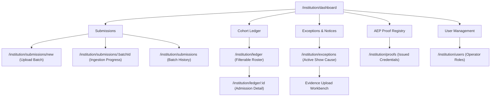
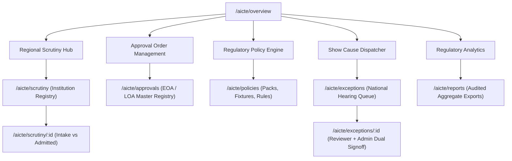

# Information Architecture Specification

| Metadata             | Value                                                                                                                                      |
| -------------------- | ------------------------------------------------------------------------------------------------------------------------------------------ |
| Document             | `docs/02-experience/information-architecture.md`                                                                                           |
| Authoritative For    | Navigation Hierarchy, Layout Shell Architecture, Workspace Sitemaps, URL Routing Tree, Breadcrumbs Contract, Multi-Tenant Context Switcher |
| Status               | `CONFIRMED`                                                                                                                                |
| Source               | PROJECT_PLAN.md §10.1, §32; [`docs/01-product/stakeholders-and-user-roles.md`](../01-product/stakeholders-and-user-roles.md)               |
| Related Requirements | [`AIRE-REQ-048`](../00-governance/requirements-traceability.md) to [`AIRE-REQ-055`](../00-governance/requirements-traceability.md)         |
| Last Updated         | 2 November 2026                                                                                                                            |

---

## 1. Global Shell Structure

All authenticated sessions across AIRE share a unified structural shell designed to maximize usable screen real estate while enforcing institutional provenance, tenant context, and role-based action boundaries.

```
+--------------------------------------------------------------------------------------------------------------------+
| [AIRE Mark]  [Institution / Regional Switcher]   [Integration Mode: MOCK|SANDBOX|PROD]    [Session / User Profile] |
+--------------------------------------------------------------------------------------------------------------------+
| SIDEBAR NAVIGATION (Collapsible)    | MAIN WORKSPACE VIEWPORT                                                      |
| - [Active Workspace Badge]          | [Breadcrumbs: Home > Submissions > 2026-27 > Batch #104]                    |
| - Primary Navigation Section 1      |                                                                              |
| - Primary Navigation Section 2      | [Screen Title & Provenance Context Bar]                                      |
| - Primary Navigation Section 3      | ---------------------------------------------------------------------------- |
| - Primary Navigation Section 4      | [Workspace Surface / Data Table / High-Density Workbench / Form Drawer]      |
|                                     |                                                                              |
| ----------------------------------- |                                                                              |
| [Audit Log Shortcut] [Help / Specs] |                                                                              |
| [Collapse Sidebar Control]          | [Footer: Regulatory Status | Clock UTC+05:30 | Security Classification]      |
+--------------------------------------------------------------------------------------------------------------------+
```

### 1.1 Shell Component Responsibilities

1. **Header Bar (`header.shell`):**
   - **Platform Identity:** Official AIRE mark and sub-label ("AICTE Admission Reconciliation & Evidence Platform").
   - **Context & Scope Switcher:** For multi-institution or multi-campus users, displays current active tenant with interactive selector dropdown. For AICTE Regional Reviewers, displays assigned region.
   - **Environment / Integration Mode Pill:** Mandatory indicator (`MOCK`, `SANDBOX`, or `PRODUCTION`) ensuring users never mistake synthetic sandbox testing for binding regulatory operations.
   - **Identity & Session Indicator:** Authenticated user full name, assigned role badge, idle timer indicator, and accessible sign-out trigger.
2. **Sidebar Navigation (`nav.sidebar`):**
   - **Workspace Context:** Prominently identifies the current role-workspace.
   - **Navigation Groups:** Logical clustering of primary tasks, active counts (e.g., pending exceptions badge), and status indicators.
   - **Collapse Mechanism:** Allows collapsing to icon-only navigation (with accessible tooltips) on viewports between 1024px and 1280px to provide maximum width for dense multi-column tabular data.
3. **Main Content Viewport (`main#content`):**
   - **Breadcrumb Navigation:** Consistent hierarchical orientation across nested routes.
   - **Context Bar:** Current academic cycle, institution approval status, and regulatory freeze countdown.
   - **Action Surface:** High-density data tables, side-by-side comparison panels, or validated form containers.
4. **Platform Footer (`footer.shell`):**
   - **Regulatory Notice:** Confidentiality notice per DPDP Act 2023 classification.
   - **Audit Timestamp:** Synchronized server timestamp in Indian Standard Time (IST / UTC+05:30).

---

## 2. Complete URL Route Tree

Route definitions adhere to deterministic semantic hierarchy. Client routes map cleanly to authorized backend REST resources (`/api/v1/*`).

```
/
├── /login                                    (Public: Better Auth local credentials)
├── /reauth                                   (Protected modal/route: Step-up authentication)
├── /verify/:token                            (Public / Verifier: Cryptographic AEP check)
│
├── /institution                              (Workspace: INST_ADMIN, INST_OPERATOR)
│   ├── /institution/dashboard                (S-10: Operational overview & countdown)
│   ├── /institution/submissions              (S-13: Submission history & sealed hashes)
│   │   ├── /institution/submissions/new      (S-11: Batch upload dropzone & mapping)
│   │   └── /institution/submissions/:batchId (S-12: Ingestion status & row quarantine)
│   ├── /institution/ledger                   (S-14: Cohort roster & quota breakdown)
│   │   └── /institution/ledger/:admissionId  (Individual student admission snapshot)
│   ├── /institution/exceptions               (S-15: Show Cause notices & compliance)
│   │   └── /institution/exceptions/:id       (S-16: Evidence upload drawer/workbench)
│   ├── /institution/proofs                   (AEP verification credential exports)
│   └── /institution/users                    (S-27: Institutional user management)
│
├── /aicte                                    (Workspace: AICTE_ADMIN, AICTE_REVIEWER)
│   ├── /aicte/overview                       (S-20: National compliance & intake metrics)
│   ├── /aicte/scrutiny                       (S-21: Regional scrutiny hub & institution roster)
│   │   └── /aicte/scrutiny/:institutionId    (Institution profile & approved vs admitted)
│   ├── /aicte/approvals                      (S-22: EOA/LOA ingestion & seat entitlements)
│   ├── /aicte/policies                       (S-23: Regulatory policy pack versions & fixtures)
│   ├── /aicte/exceptions                     (S-24: Show Cause dispatcher & hearing queue)
│   │   └── /aicte/exceptions/:id             (S-25: Exception review & dual sign-off workbench)
│   └── /aicte/reports                        (S-17: Audited regulatory exports & analytics)
│
├── /student                                  (Workspace: STUDENT)
│   ├── /student/record                       (S-30: Personal admission entitlement card)
│   ├── /student/credential                   (S-31: AEP certificate view & SVG QR code)
│   └── /student/correction                   (S-32: Demographic correction request form)
│
└── /auditor                                  (Workspace: AUDITOR)
    ├── /auditor/logs                         (S-39: Immutable append-only audit explorer)
    └── /auditor/replay                       (S-40: Temporal regulatory replay simulator)
```

---

## 3. Institution Workspace Sitemap (`/institution`)

Designed for institutional operators and registrars to process admissions under strict regulatory deadlines.



### Detailed Section Breakdown

1. **Dashboard (`/institution/dashboard`):**
   - Real-time countdown timer to the annual AICTE submission freeze date.
   - Aggregate admission counter: Approved Intake vs. Draft vs. Validated vs. Sealed.
   - Urgent notices banner: Active Show Cause notices with response deadlines.
   - APAAR identity verification health card: Percent verified vs. pending vs. unverified.
2. **Submissions (`/institution/submissions`):**
   - _Upload Batch (`/institution/submissions/new`):_ Multi-part upload for CSV/XLSX. Drag-and-drop target with automatic mime-type and header inspection.
   - _Ingestion Workbench (`/institution/submissions/:batchId`):_ Real-time progress polling (or WebSocket/SSE), error summary metrics, and defective row quarantine table with inline fix suggestions.
   - _Sealed Cohorts (`/institution/submissions`):_ Historical archive of signed-off batches with cryptographic SHA-256 Merkle root hashes and AICTE timestamp receipts.
3. **Cohort Ledger (`/institution/ledger`):**
   - High-density tabular roster of all enrolled students.
   - Column filters: Programme / Branch, Reservation Category (General, OBC, SC, ST, EWS), Quota Type (State Merit, Management, NRI, FN/OCI, Lateral Entry), APAAR status, Entitlement status.
   - Action: View individual admission chronology and immutable audit history.
4. **Exceptions & Legal Notices (`/institution/exceptions`):**
   - Queue of active compliance flags and AICTE Show Cause notices.
   - Detail view: Specific rule breach notice, calculated quota surplus, and countdown to regulatory escalation.
   - Evidence submission drawer: Upload counter-affidavits, seat cancellation orders, and fee refund receipts.
5. **AEP Proof Registry (`/institution/proofs`):**
   - Directory of generated Admission Entitlement Proofs.
   - Batch export controls for institutional student verification.

---

## 4. AICTE Regulatory Workspace Sitemap (`/aicte`)

Designed for regional reviewers and headquarters administrators to monitor institutional compliance, scrutinize cohorts, and execute deterministic enforcement.



### Detailed Section Breakdown

1. **National Compliance Overview (`/aicte/overview`):**
   - Macro KPIs: Total AICTE Institutions, Total Approved Intake, Total Reported Admissions, System-wide Mismatch Rate.
   - National Heatmap: Breakdown by State/UT, Discipline (Engineering, Management, Pharmacy, Architecture), and Discrepancy Severity.
   - System Ingestion Health: Total active worker jobs, queue latency, and adapter status.
2. **Regional Scrutiny Hub (`/aicte/scrutiny`):**
   - Scoped directory of institutions filtered by regional jurisdiction (Northern, Southern, Western, Eastern, etc.).
   - Comparison matrix: Approved Seats (EOA) vs. Sealed Admissions vs. Ghost Seats vs. Over-admissions.
3. **Approval Order Management (`/aicte/approvals`):**
   - Digital repository of Extension of Approval (EOA) and Letter of Approval (LOA) orders.
   - Structured programme entitlement parser: Category-wise approved caps (Supernumerary, TFW, NRI, PIO, FN).
   - Version comparison viewer: Side-by-side diff between original EOA and mid-term amendments.
4. **Regulatory Policy Engine (`/aicte/policies`):**
   - Master catalog of versioned policy packs linked to academic handbook clauses.
   - Rule fixture test-runner: Interactive execution of test fixtures against rule handlers before production activation.
   - Activation sign-off console: Multi-signature activation workflow preserving historical policy snapshots.
5. **Show Cause Dispatcher & Workbench (`/aicte/exceptions`):**
   - Multi-institutional exception triage queue.
   - Exception Investigation Workbench (`/aicte/exceptions/:id`): Complete evidence timeline, mathematical rule breach trace, and institutional evidence inspector.
   - Dual-Authorization Modal: Primary reviewer recommendations paired with approving officer signature prompt.

---

## 5. Student, Verifier, and Auditor Sitemaps

### 5.1 Student Portal (`/student`)

- **/student/record (S-30):** Focused card presenting student's verified admission details, programme, institution, approval order reference, and APAAR verification state.
- **/student/credential (S-31):** Full Admission Entitlement Proof (AEP) card with dynamic high-contrast SVG QR code, cryptographic hash badge, and secure PDF export.
- **/student/correction (S-32):** Minimal demographic correction request form routing directly to the student's admitted institution.

### 5.2 External Verifier Portal (`/verify`)

- **/verify/:token (S-38):** Decoupled, public-facing verification terminal. Scans QR code or accepts raw cryptographic token; renders cryptographically validated green/red entitlement authenticity status without exposing sensitive student contact details.

### 5.3 Auditor Workbench (`/auditor`)

- **/auditor/logs (S-39):** Filterable explorer querying the immutable append-only audit trail (`audit_events`). Filters by Actor, Tenant, Action Code, Correlation ID, and Date Range. Displays JSON diffs of sensitive state transitions.
- **/auditor/replay (S-40):** Simulation environment to re-run historical reconciliation runs under current or historical policy packs to verify determinism and evaluate regulatory rule changes.

---

## 6. Breadcrumbs Contract

Breadcrumb trails are mandatory on every screen within the main content viewport to prevent spatial disorientation during deep investigative workflows.

### 6.1 Generation Rules

1. **Root Label:** Represents the active workspace (e.g. `Institution`, `AICTE Scrutiny`, `Auditor`).
2. **Dynamic Segments:**
   - Batches display: `Batch #{batchNumber}`.
   - Institutions display: `{institutionCode} - {abbreviatedName}`.
   - Exceptions display: `Notice #{noticeId}`.
   - Admissions display: `Student #{maskedAdmissionId}`.
3. **Truncation & Max Length:** Intermediate segments exceeding 24 characters truncate with an ellipsis (`...`), while preserving the full name in the browser tooltip (`title` attribute). The active terminal segment is bold and unlinked.
4. **State Persistence:** Clicking an ancestor breadcrumb link restores that view's query string parameters (filters, page, sorting) cached in sessionStorage.

### 6.2 Structural Examples

| Screen Type         | Route                          | Breadcrumb Path                                        |
| ------------------- | ------------------------------ | ------------------------------------------------------ |
| Ingestion Status    | `/institution/submissions/104` | `Institution > Submissions > Batch #104`               |
| Exception Review    | `/aicte/exceptions/SC-2026-88` | `AICTE > Exceptions > Show Cause #SC-2026-88`          |
| Institution Profile | `/aicte/scrutiny/1-3324567`    | `AICTE > Scrutiny > Western Region > VJTI (1-3324567)` |
| Student Credential  | `/student/credential`          | `Student Portal > Entitlement Proof (AEP)`             |

---

## 7. Multi-Tenant Context Switcher

For users assigned to multiple institutions or campuses (e.g. university registrars overseeing multiple affiliated campuses) or AICTE reviewers assigned to multiple territories:

1. **Location:** Integrated directly into the top shell header immediately adjacent to the AIRE logo.
2. **Presentation:** Displays active institution name, AICTE Permanent Institute ID, and campus badge with a chevron indicator.
3. **Switch Interaction:**
   - Clicking opens a search-enabled dropdown listing all authorized tenant memberships.
   - Selecting a new institution initiates an atomic context transition:
     1. Unsaved changes check is evaluated; user is prompted if dirty forms exist.
     2. Session tenant context is updated.
     3. Active queries in TanStack Query cache are evicted immediately to prevent cross-tenant data leakage.
     4. Navigation redirects to the target institution's dashboard (`/institution/dashboard`).
     5. Backend verifies membership and binds database transactions to the new `tenant_id` via PostgreSQL RLS.

---

## 8. Navigation State, Persistence & Error Boundaries

### 8.1 Active State Representation

- **Visual Marker:** Active sidebar links feature a prominent border highlight (`border-l-4 border-indigo-600`), contrasting surface color (`bg-slate-100 text-slate-900 font-semibold`), and an accessible `aria-current="page"` attribute.
- **Badge Indicators:** Real-time numerical badges denote actionable workload counts (e.g., `3` unread Show Cause notices).

### 8.2 Permission-Driven Visibility

- Navigation items are displayed only if the active session possesses the corresponding permission code (`institution.read`, `submission.create`, `exception.resolve`, etc.).
- **Security Rule:** Hiding sidebar links is purely a usability convenience. The client router enforces protected route guards, and backend controllers enforce strict permission checks and forced PostgreSQL RLS on every single request.

### 8.3 Route Error & Not Found Handling

- **404 Route Not Found:** Displays a calm institutional error screen indicating that the requested URL does not exist, providing a direct button to return to the active workspace dashboard.
- **403 Unauthorized:** Rendered when a user navigates to a valid route outside their assigned scope. Displays:
  - Error code: `ACCESS_DENIED_SCOPE_MISMATCH`.
  - Correlation ID.
  - Plain English explanation: _"Your account does not hold authorization to access this institution or regulatory workflow."_
  - Clean action: _"Return to Authorized Workspace."_
