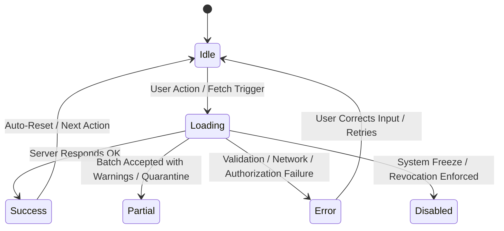

# Interaction Contracts Specification

| Metadata             | Value                                                                                                                                |
| -------------------- | ------------------------------------------------------------------------------------------------------------------------------------ |
| Document             | `docs/02-experience/interaction-contracts.md`                                                                                        |
| Authoritative For    | Component State Machines, Form Behaviors, High-Impact Double-Confirmation Modals, Data Grids, File Ingestion, and Session Lifecycles |
| Status               | `CONFIRMED`                                                                                                                          |
| Source               | PROJECT_PLAN.md §10.2, §10.3, §24, §30; [`docs/02-experience/experience-overview.md`](./experience-overview.md)                      |
| Related Requirements | [`AIRE-REQ-078`](../00-governance/requirements-traceability.md) to [`AIRE-REQ-083`](../00-governance/requirements-traceability.md)   |
| Last Updated         | 2 November 2026                                                                                                                      |

---

## 1. Six-State Component State Machine

Every interactive surface, data card, form control, and data table across AIRE must implement the standard six-state deterministic state machine:

$$	ext{Idle} \longrightarrow 	ext{Loading} \longrightarrow 	ext{Success} \mid 	ext{Partial} \mid 	ext{Error} \mid 	ext{Disabled}$$

### Detailed State Requirements

| State        | Visual Treatment                                                                                     | Behavioral Contract                                                                                                    | Accessibility & Focus                                                           |
| ------------ | ---------------------------------------------------------------------------------------------------- | ---------------------------------------------------------------------------------------------------------------------- | ------------------------------------------------------------------------------- |
| **Idle**     | Clean, accessible baseline rendering. Subdued slate borders (`border-slate-300`).                    | Interactive controls accept pointer, keyboard, and touch input.                                                        | Standard Tab sequence; visible focus indicator (`focus-visible:ring-2`).        |
| **Loading**  | Non-blocking skeleton loader matching the geometry of the target table or card. Zero layout shift.   | Buttons display inline spinner + _"Processing..."_; controls disabled to prevent duplicate writes.                     | `aria-busy="true"`, `aria-live="polite"` announcing loading to screen readers.  |
| **Success**  | Non-disruptive emerald feedback banner or top-right toast.                                           | Data views refresh automatically. Action controls reset cleanly.                                                       | `aria-live="polite"` announcing completion message.                             |
| **Partial**  | Split presentation: green summary card for accepted items, amber summary card for quarantined items. | Clean items proceed into the pipeline; defective items are isolated in the quarantine table for inline remediation.    | Explicit badge counts and focus moved to error summary.                         |
| **Error**    | Red border (`border-rose-500`) with concise human-readable message citing rule citation.             | Form data preserved; focus auto-shifts to first invalid field; retry trigger available for transient network errors.   | `aria-invalid="true"`, `aria-errormessage` linking to error text.               |
| **Disabled** | Visually subdued (`opacity-50 cursor-not-allowed bg-slate-100`).                                     | Tooltip or persistent banner explains why the action is locked (e.g. freeze deadline passed or role lacks permission). | `aria-disabled="true"`; element remains focusable if explanation is in tooltip. |

---

## 2. Navigation & Breadcrumb Contract

1. **Breadcrumb Generation:**
   - Evaluated dynamically from route segments. Top-level segments represent the workspace root. Dynamic segments display human-readable identifiers (e.g. `Batch #104`, `Notice #SC-2026-88`).
   - Ancestor segments are interactive links. The active terminal segment is bold, unlinked, and marked with `aria-current="location"`.
2. **Back Navigation & State Restoration:**
   - Navigating backwards via breadcrumbs or browser back button preserves table filters, page offset, and scroll position (restored from `sessionStorage`).
3. **Dirty Form Protection:**
   - If the user attempts to navigate away from an uncommitted form (e.g. editing quarantine rows or drafting Show Cause notice), a non-blocking dialog intercepts: _"You have unsaved changes. Do you wish to discard them or remain on this page?"_

---

## 3. Form Validation & Field Contracts

1. **Validation Timing:**
   - **On Blur (Initial):** Field validation executes when the user tabs out of an input field. Prevents premature error messages while typing.
   - **On Change (Post-Error):** Once a field is in error state, validation runs on every keystroke/change to clear the red error border the moment valid input is entered.
   - **On Submit (Comprehensive):** Full Zod schema validation checks all fields. If errors exist, submission is blocked and focus moves to the first invalid field.
2. **Field Error Presentation:**
   - Error messages render directly below the input field in concise plain English with red text (`text-rose-600 text-xs font-medium`).
   - Inputs are linked via `aria-describedby` pointing to the error message ID.
3. **Multi-Step Form Preservation:**
   - Step-based workflows (e.g. Batch Ingestion: File Select $\rightarrow$ Column Map $\rightarrow$ Validation) cache validated step payloads so clicking _"Back"_ preserves previously configured mappings.

---

## 4. Search & Filtering Contracts

1. **Search Input Debounce:**
   - Text search inputs across tables (Cohort Ledger, Scrutiny Hub, Audit Explorer) implement a standard **300ms debounce** to prevent query storms.
   - Active search renders an inline clear button (`X` icon) clearing query string and resetting focus to input.
2. **URL Query Parameter Synchronization:**
   - Active search filters (`?programme=BTECH_CSE&category=OBC&page=2`) are mirrored in URL search params, enabling bookmarking and reproducible audit inspection.
3. **No-Results State:**
   - When filters match zero records, the table renders a dedicated _"No matching records found"_ state with a clean action: _"Clear all filters"_.

---

## 5. High-Density Data Tables Contract

Data tables in AIRE handle institutional cohorts, regional scrutiny, and statutory audit logs:

1. **Row Density:** Compact 36px–40px row height maximizing visible rows on standard 1080p monitors.
2. **Sortable Headers:**
   - Clicking column header toggles: `Ascending` $\rightarrow$ `Descending` $\rightarrow$ `Default`.
   - Programmatic `aria-sort="ascending|descending"` on `<th>` elements.
3. **Server-Side Pagination:**
   - Standard page size: 50 records. Controls: First, Previous, Page Indicator (`Page X of Y`), Next, Last.
   - Total record count always visible: _"Showing 1–50 of 862 records"_.
4. **Row Selection & Bulk Actions:**
   - Checkbox column enables individual and select-all actions.
   - Selecting rows opens an action bar: _"12 rows selected — [Re-evaluate Selected] [Export Selection]"_.

---

## 6. Dialogs & Modal Contracts

1. **Focus Trap:** When any modal opens, keyboard focus transfers to the first interactive element. Pressing `Tab` or `Shift+Tab` cycles exclusively within the modal.
2. **Dismissal Protocol:**
   - Non-destructive informational modals dismiss via `Escape` key or clicking the backdrop.
   - Irreversible confirmation modals (Sealing, Show Cause issuance) **cannot be closed by clicking the backdrop**, preventing accidental dismissals.
3. **Background Scroll Lock:** Opening a modal or drawer locks `document.body` scrolling (`overflow: hidden`).

---

## 7. Irreversible Action Confirmation Contracts

High-impact regulatory mutations demand explicit, multi-step double-confirmation contracts:

### 7.1 Cohort Sealing Confirmation (`S-13` / `S-14`)

- **Pre-requisite:** 100% of records in batch are in `VALIDATED` status.
- **Modal Displays:**
  - Total Headcount to be sealed.
  - APAAR verified percentage vs unverified count.
  - Approved Intake Ceiling vs Admitted count.
  - Prominent Warning: _"Sealing is irreversible. Records will be cryptographically locked with a SHA-256 Merkle root hash."_
  - Mandatory Attestation Checkbox: _"I certify under penalty of regulatory action under the AICTE Act that these admissions represent genuine students complying with approved intake orders."_
  - Password Input: If session authentication age $> 15\text{ min}$.
  - Action Button: _"Seal Cohort & Lock Admissions"_ (Disabled until attestation checked).

### 7.2 Show Cause Notice Issuance (`S-24`)

- **Modal Displays:**
  - Violated AICTE Regulation & APH Clause Number.
  - Calculated Quota Surplus (e.g. `+4 Excess Seats`).
  - Response Window Selector: `7 Days`, `14 Days` (Default), `21 Days`.
  - Action Button: _"Dispatch Formal Show Cause Notice"_.

### 7.3 Dual-Authorization Exception Closure (`S-25`)

- **Enforces Separation of Duties:**
  - Reviewer enters recommendation (`RESOLVED_COMPLIANT`, `RESOLVED_PENALTY`).
  - Executive Administrator (`AICTE_ADMIN`) reviews findings.
  - System verifies `reviewer.id != approver.id`.
  - Approver enters step-up password and clicks _"Co-Sign and Execute Resolution"_.

---

## 8. Toast Notifications & System Feedback

1. **Positioning:** Fixed top-right, 16px from viewport edges (`top-4 right-4 z-50`).
2. **Durations & Dismissal:**
   - **Informational (Green/Blue):** Auto-dismisses after 4,000ms. Slide-out animation.
   - **Warning (Amber):** Auto-dismisses after 6,000ms. Accessible dismiss button.
   - **Error (Red):** **Never auto-dismisses**. Requires explicit user click on dismiss `X` button. Displays monospace Correlation ID (e.g. `cor-882f-1049`) with copy button.
3. **Stacking:** Maximum 3 visible toasts stacked vertically; older toasts collapse into counter.
4. **Accessibility:** Toast container uses `role="status"` and `aria-live="polite"`. Critical security errors use `role="alert"` and `aria-live="assertive"`.

---

## 9. Session Lifecycle & Idle Expiration

1. **Idle Monitoring (30-Minute Boundary):**
   - At minute 25 of zero user activity: Modal appears with 5-minute live countdown: _"Your session will expire in 5:00 due to inactivity. Click 'Continue Session' to remain logged in."_
   - Clicking _"Continue Session"_ touches the backend session endpoint and resets timer.
   - At minute 30: Client purges in-memory caches and redirects to `/login?reason=session_expired`.
2. **Absolute Timeout (8 Hours):**
   - At hour 8, session terminates regardless of activity; user is redirected to re-authenticate.

---

## 10. Network Failure & Resilient Retry

1. **Idempotent Read Operations (GET):**
   - Failed queries execute automatic retry using exponential backoff (attempt 1: 1s, attempt 2: 2s, attempt 3: 4s).
   - If exhausted, renders calm inline error card with _"Retry Request"_ button.
2. **Mutating Write Operations (POST, PUT, DELETE):**
   - **Zero automated retries** for write operations to prevent duplicate batch creation or double submissions.
   - User is presented with explicit error banner: _"Transaction Failed: Network connection lost before server response. Please verify submission history before retrying."_
