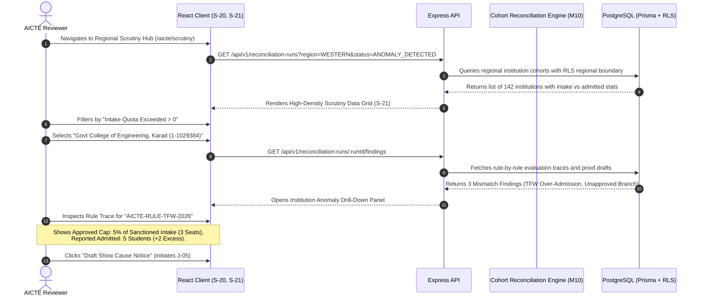

# J-04 — AICTE Regional Scrutiny & Multi-Pass Reconciliation

| Metadata            | Value                                                                                                                                                                                                                                                                              |
| ------------------- | ---------------------------------------------------------------------------------------------------------------------------------------------------------------------------------------------------------------------------------------------------------------------------------- |
| Journey ID          | `J-04`                                                                                                                                                                                                                                                                             |
| Journey Title       | AICTE Regional Scrutiny, Intake Comparison & Multi-Pass Reconciliation                                                                                                                                                                                                             |
| Status              | `CONFIRMED`                                                                                                                                                                                                                                                                        |
| Primary Personas    | `AICTE_REVIEWER` (Primary), `AICTE_ADMIN` (Executive Reviewer)                                                                                                                                                                                                                     |
| Source Requirements | [`AIRE-REQ-033`](../../00-governance/requirements-traceability.md) to [`AIRE-REQ-040`](../../00-governance/requirements-traceability.md), [`AIRE-REQ-160`](../../00-governance/requirements-traceability.md) to [`AIRE-REQ-168`](../../00-governance/requirements-traceability.md) |
| Related Screens     | [`S-20`](../screen-specifications/S-20-national-overview.md), [`S-21`](../screen-specifications/S-21-regional-scrutiny.md), [`S-25`](../screen-specifications/S-25-exception-detail.md)                                                                                            |
| Last Updated        | 2 November 2026                                                                                                                                                                                                                                                                    |

---

## 1. Goal & Context

An AICTE scrutiny officer or regional reviewer (`AICTE_REVIEWER`) inspects reported admission cohorts across technical institutions within their regional jurisdiction. The reviewer triggers or reviews automated, deterministic multi-pass reconciliation runs. The platform mathematically evaluates reported student admissions against approved Extension of Approval (EOA) intake ceilings, reservation category formulas, supernumerary quotas (TFW, NRI, FN), and cross-institution concurrent enrolments, classifying discrepancies into an auditable taxonomy of regulatory findings.

---

## 2. Preconditions

- User is authenticated with `AICTE_REVIEWER` or `AICTE_ADMIN` role.
- Regional jurisdiction scope is established (e.g. Western Regional Office: Maharashtra, Goa).
- Target institutions have sealed their admission cohorts or the regulatory freeze date has elapsed.
- Authoritative AICTE Approval Orders (EOA) and active Regulatory Policy Packs are locked in PostgreSQL.

---

## 3. Entry Point

- AICTE Regional Scrutiny Hub (`/aicte/scrutiny`), filtering by state, university affiliation, or discrepancy flag.
- National Compliance Overview (`/aicte/overview`), clicking into a high-severity regional anomaly on the compliance heatmap.

---

## 4. Main Success Path

### Detailed Operational Steps

1. **Regional Overview & Filtering (`S-21`):**
   - The scrutiny officer views the Regional Table containing all assigned technical institutes:
     - Permanent Institute ID & Name.
     - Total Sanctioned Seats (Approved EOA).
     - Total Sealed Admissions.
     - Variance (+/-).
     - Reconciliation Health Status:
       - `COMPLIANT` (Green): 100% adherence to all policy quotas.
       - `WARNING` (Amber): Minor demographic formatting discrepancies or unverified APAAR (<5%).
       - `CRITICAL_MISMATCH` (Red): Over-admissions, unauthorized programmes, concurrent enrolments.
2. **Executing Multi-Pass Reconciliation:**
   - The engine automatically executes four deterministic mathematical passes:
     - **Pass 1 — Macro Sanctioned Ceiling Check:** Total Admitted $\le$ Total Sanctioned.
     - **Pass 2 — Category & Quota Disaggregation:** OBC/SC/ST/EWS percentages verified against state reservation orders; TFW (Tuition Fee Waiver) $\le 5\%$ of sanctioned intake; NRI/FN/OCI within statutory caps.
     - **Pass 3 — Academic Identity Verification:** APAAR verification status check via Identity Vault token matching.
     - **Pass 4 — Concurrent Enrolment Detection:** Cross-queries nationwide hash tokens to detect whether the same student is reported in two simultaneous full-time technical degree programmes.
3. **Anomaly Inspection Workbench:**
   - Reviewer clicks an institution flagged as `CRITICAL_MISMATCH`.
   - The drill-down view presents:
     - Programme: _B.Tech Mechanical Engineering_.
     - Sanctioned Intake: 60.
     - Admitted Count: 64.
     - Mathematical Rule Trace: Direct link to AICTE Approval Process Handbook (APH) 2026-27 Clause 4.2.
     - List of 4 unentitled student records identified chronologically by latest admission date.
4. **Outcome Formulation:**
   - Reviewer confirms that the automated finding is mathematically reproducible and not an artifact of an unrecorded amendment order.
   - Proceeds to trigger formal regulatory action by initiating Journey `J-05` (Show Cause Notice).

---

## 5. Alternate & Failure Paths

### 5.1 Amendment Order Supersession

- If an institution claims an over-admission is authorized under a recent AICTE amendment order that was not yet ingested:
  - Reviewer navigates to Approval Management (`S-22`).
  - Uploads the amendment order document; system updates the authoritative entitlement registry version.
  - Reviewer clicks _"Re-run Reconciliation"_.
  - Engine executes a fresh run, supersedes the previous findings, and updates status to `COMPLIANT`.

### 5.2 Concurrent Enrolment Ambiguity

- When Pass 4 flags a student enrolled in two institutions:
  - System distinguishes between prohibited concurrent full-time degrees vs. permitted simultaneous online/distance diplomas under UGC Guidelines.
  - Reviewer is presented with an _"Ambiguous Identity Match Drawer"_ to request clarification rather than immediately issuing a fraud verdict.

---

## 6. Privacy & Authority Safeguards

- **Zero Raw PII Exposure:** When inspecting student lists in discrepancy views, reviewers see Roll Numbers, Admission Dates, Quota Codes, and masked Student Names. Raw Aadhaar and phone numbers are omitted.
- **Deterministic Traceability:** Every discrepancy references the exact immutable input snapshot hash and policy pack version, ensuring that historical evaluations can be reproduced down to the byte.
