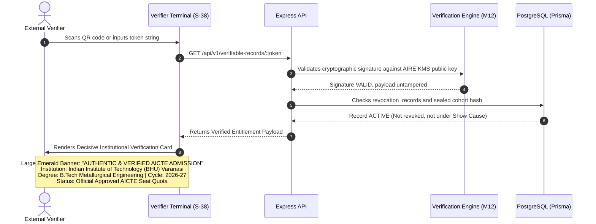

# J-07 — Public Cryptographic AEP Verification

| Metadata            | Value                                                                                                                                                                                                                                                                              |
| ------------------- | ---------------------------------------------------------------------------------------------------------------------------------------------------------------------------------------------------------------------------------------------------------------------------------- |
| Journey ID          | `J-07`                                                                                                                                                                                                                                                                             |
| Journey Title       | Public Cryptographic Admission Entitlement Proof (AEP) Verification                                                                                                                                                                                                                |
| Status              | `CONFIRMED`                                                                                                                                                                                                                                                                        |
| Primary Personas    | `VERIFIER` (Employer, University Admissions Officer, Credential Evaluator)                                                                                                                                                                                                         |
| Source Requirements | [`AIRE-REQ-052`](../../00-governance/requirements-traceability.md) to [`AIRE-REQ-053`](../../00-governance/requirements-traceability.md), [`AIRE-REQ-193`](../../00-governance/requirements-traceability.md) to [`AIRE-REQ-196`](../../00-governance/requirements-traceability.md) |
| Related Screens     | [`S-38`](../screen-specifications/S-38-verifier-card.md)                                                                                                                                                                                                                           |
| Last Updated        | 2 November 2026                                                                                                                                                                                                                                                                    |

---

## 1. Goal & Context

An external verifier (such as a corporate background check investigator, a foreign university admissions evaluator, or a state licensing authority) validates the authenticity of a student's technical education degree claim. The verifier scans the high-contrast QR code on the student's Admission Entitlement Proof (AEP) certificate or pastes the token string into the public verification terminal (`/verify/:token`). AIRE executes an instant cryptographic signature and database ledger check, confirming that the student's admission was officially sanctioned under an approved AICTE intake quota, while strictly protecting student privacy by exposing zero phone numbers, email addresses, or unneeded personal attributes.

---

## 2. Preconditions

- The student's admission has been sealed by the institution and evaluated as `COMPLIANT` by the Reconciliation Engine.
- An official Admission Entitlement Proof (AEP) has been minted and signed with AIRE's KMS private key.
- Verifier possesses the AEP QR code or URL string. No account login is required (public verification endpoint).

---

## 3. Entry Point

- Scanning the dynamic QR code on a printed or digital AEP document with a smartphone camera or 2D barcode scanner.
- Direct navigation to `https://aire.aicte-india.org/verify/:token` (`S-38`).

---

## 4. Main Success Path

### Detailed Operational Steps

1. **Token Ingestion & Verification Trigger (`S-38`):**
   - The verifier opens the verification URL.
   - The terminal validates the structure of the verification token (Base64URL encoded signed payload).
2. **Cryptographic Signature & Revocation Evaluation:**
   - Server validates the digital signature using AIRE's public key certificate.
   - Cross-references the unique proof serial against the `revocation_records` table to ensure the certificate has not been cancelled due to fraudulent reporting or college derecognition.
3. **Displaying the Institutional Outcome:**
   - The screen renders an authoritative, high-contrast verification badge:
     - **Verification Outcome:** `AUTHENTIC & LEGITIMATE ADMISSION` (Large Emerald Shield).
     - **Student Name:** Displayed as official legal name (e.g. _"Rohan Sharma"_).
     - **Institution:** Full official name and Permanent Institute ID.
     - **Degree Programme:** E.g. _"Bachelor of Technology in Metallurgical Engineering"_.
     - **Admission Year:** _"2026-2027"_.
     - **AICTE Approval Reference:** Official EOA Order Number.
     - **Tamper Evidence Seal:** Sourced from cryptographic batch Merkle root hash.
4. **Third-Party Record Export:**
   - Verifier clicks _"Download Verification Summary Report"_ (generates a one-page audit receipt with timestamp for corporate background screening files).

---

## 5. Alternate & Failure Paths

### 5.1 Invalid or Tampered Token

- If the token signature does not match or the string has been altered:
  - Screen renders a prominent red alert:
    - **Outcome:** `INVALID / TAMPERED CREDENTIAL`.
    - **Explanation:** _"The digital signature on this verification token is invalid. This document could not be authenticated against the AICTE master ledger."_

### 5.2 Revoked or Cancelled Admission

- If the student cancelled their seat or the institution's quota was revoked:
  - Screen renders an amber warning:
    - **Outcome:** `ADMISSION RECORD SUPERSEDED / REVOKED`.
    - **Details:** Date of cancellation and regulatory reason code.

---

## 6. Privacy by Design: Zero Sensitive PII

Under Section 15 of the master plan and DPDP Act 2023 principles:

- The public verification view **strictly excludes**:
  - Student phone numbers and residential addresses.
  - Student email addresses.
  - Raw APAAR or Aadhaar identifiers.
  - Parental names or caste/reservation category classifications.
- Only the minimum verifiable educational claim (Candidate Name, Admitted Institution, Approved Degree Programme, Academic Year) is disclosed.
