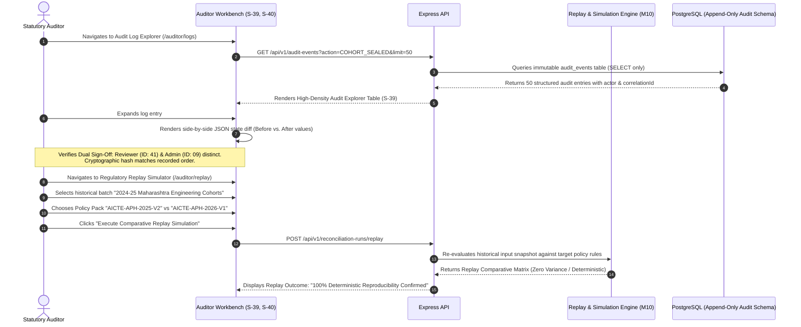

# J-08 — Auditor Inspection & Temporal Regulatory Replay

| Metadata            | Value                                                                                                                                                                                                                                                                            |
| ------------------- | -------------------------------------------------------------------------------------------------------------------------------------------------------------------------------------------------------------------------------------------------------------------------------- |
| Journey ID          | `J-08`                                                                                                                                                                                                                                                                           |
| Journey Title       | Independent Audit Inspection & Temporal Regulatory Replay Simulation                                                                                                                                                                                                             |
| Status              | `CONFIRMED`                                                                                                                                                                                                                                                                      |
| Primary Personas    | `AUDITOR` (Statutory Auditor, Ministry / CAG Oversight Officer)                                                                                                                                                                                                                  |
| Source Requirements | [`AIRE-REQ-054`](../../00-governance/requirements-traceability.md), [`AIRE-REQ-055`](../../00-governance/requirements-traceability.md), [`AIRE-REQ-114`](../../00-governance/requirements-traceability.md) to [`AIRE-REQ-119`](../../00-governance/requirements-traceability.md) |
| Related Screens     | [`S-39`](../screen-specifications/S-39-audit-explorer.md), [`S-40`](../screen-specifications/S-40-regulatory-replay.md)                                                                                                                                                          |
| Last Updated        | 2 November 2026                                                                                                                                                                                                                                                                  |

---

## 1. Goal & Context

A statutory regulatory auditor (`AUDITOR`) conducts independent oversight of the platform's integrity. The auditor queries the immutable, append-only audit log explorer (`/auditor/logs`), inspecting structured JSON diffs of sensitive administrative actions (e.g. cohort sealing, Show Cause notice dispatch, dual-sign-off exception closures, and policy activations). Furthermore, the auditor executes the **Temporal Regulatory Replay Simulator** (`/auditor/replay`) to re-run historical reconciliation runs under both historical and contemporary policy rules, verifying mathematical determinism and measuring the retroactive impact of regulatory policy changes without altering historical legal verdicts.

---

## 2. Preconditions

- User is authenticated with `AUDITOR` role.
- Auditor holds read-only access across platform audit schemas.
- Replay engine has access to immutable historical admission snapshots and versioned policy packs.

---

## 3. Entry Point

- Direct navigation to Auditor Workbench (`/auditor/logs` or `/auditor/replay`).

---

## 4. Main Success Path

### Detailed Operational Steps

1. **Querying Immutable Logs (`S-39`):**
   - The auditor accesses the Audit Log Explorer.
   - Applies granular search filters:
     - Actor ID or Email.
     - Action Code (e.g. `COHORT_SEALED`, `SHOW_CAUSE_ISSUED`, `EXCEPTION_RESOLVED`, `POLICY_ACTIVATED`).
     - Correlation ID (tracing a specific HTTP transaction across all layers).
     - Target Institution ID.
     - Timestamp Range (IST).
   - Results render in a compact 36px data grid.
2. **State Transition Diff Inspection:**
   - Clicking an audit record expands an inline diff inspector.
   - Shows:
     - Actor identity and verified IP hash.
     - Purpose authorization token (`PURPOSE_REGULATORY_AUDIT`).
     - Structured JSON payload:
       - `before_state`: Pre-mutation record values.
       - `after_state`: Post-mutation record values.
     - Cryptographic verification that the audit record itself has not been altered.
3. **Simulating Regulatory Replay (`S-40`):**
   - Auditor transitions to the Replay Simulator.
   - Configures a replay run:
     - Selects historical cohort snapshot: e.g. _"All Western Region Polytechnic Admissions 2025-26"_.
     - Selects baseline policy version used during original evaluation.
     - Clicks _"Verify Historical Determinism"_.
   - The engine processes the immutable snapshot and compares the computed findings against the stored historical results:
     - **Variance Check:** 0 mismatches detected (100% deterministic reproducibility).
4. **Impact Analysis of Proposed Rule Changes:**
   - Auditor selects a prospective or draft policy pack (e.g. modifying TFW income ceiling from 6 LPA to 8 LPA).
   - Replay engine identifies which historical records would change from `NON_COMPLIANT` to `COMPLIANT`.
   - Generates an **Impact Analysis Report** without modifying the historical authoritative database.

---

## 5. Alternate & Failure Paths

### 5.1 Verification Mismatch / Non-Determinism Alert

- In the exceedingly rare event that re-running an identical snapshot against an identical policy pack yields a different result:
  - System raises a critical statutory integrity alert: `INTEGRITY_BREACH_DETERMINISM_VIOLATION`.
  - Details the precise rule calculation discrepancy for immediate engineering and legal review.

### 5.2 Attempted Audit Log Mutation

- If any application user or compromised account attempts an `UPDATE` or `DELETE` query on `audit_events`:
  - PostgreSQL database trigger immediately raises an uncatchable exception: `ERROR: audit_events table is append-only. Mutation forbidden.`
  - Security event is simultaneously written to independent system logging.

---

## 6. Read-Only Boundary

- The `AUDITOR` workspace contains **zero mutation buttons, zero upload forms, and zero approval actions**. It is an information-dense, analytical environment designed for institutional verification and public trust.
