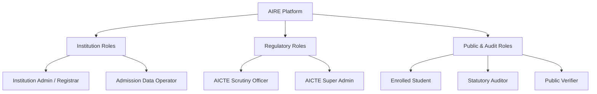

# AIRE — Stakeholder Personas & Role Profiles

| Metadata     | Value                                       |
| ------------ | ------------------------------------------- |
| Document     | `docs/04-frontend/personas.md`              |
| Status       | `APPROVED` (Evidence-based Role Hypotheses) |
| Reference    | UX4G Handbook Chapter 2 (Personas)          |
| Last Updated | 3 November 2026                             |

---

## 1. Role Matrix Overview

All personas represent functional role archetypes defined in `docs/01-product/stakeholders-and-user-roles.md`.

---

## 2. Profile: Admission Data Operator (Institutional)

- **Role:** Operator / Junior Registrar
- **Primary Objective:** Ingest student admission lists from campus ERP into AIRE before the statutory deadline without data loss.
- **Key Tasks:**
  - Export CSV/Excel from college ERP.
  - Upload batch to AIRE.
  - Fix row-level formatting discrepancies in Quarantine Triage.
  - Hand over clean sealed batch to Registrar for final submission.
- **Key Pain Points:**
  - Rigid schemas that reject entire 500-student files over one invalid date format.
  - Ambiguous error messages like "Row 42 failed validation".
  - Complex manual field re-mapping on every upload.
- **UX Requirements:**
  - Header auto-detection with plain confirmation UI.
  - Inline editing for quarantined records with instant re-validation.
  - Downloadable error summary reports.

---

## 3. Profile: Institution Registrar (Institutional Admin)

- **Role:** Head of Admissions / Registrar
- **Primary Objective:** Legally certify institutional compliance with approved intake caps and quota allocations.
- **Key Tasks:**
  - Review aggregate intake utilization across all engineering branches.
  - Verify supernumerary quotas (EWS, TFWS, J&K, PMSSS).
  - Authorize the final irreversible cohort seal with step-up authentication.
  - Respond to Show Cause notices and submit clarifying evidence.
- **Key Pain Points:**
  - Fear of accidental submission of unverified cohorts.
  - Lack of visibility into which quota category is overflowing.
- **UX Requirements:**
  - High-level branch summary cards with clear intake progress bars (e.g., 58/60 enrolled).
  - Prominent dual-confirmation dialogs before irreversible sealing.
  - Timestamped history of all submitted batches.

---

## 4. Profile: AICTE Scrutiny Officer (Regulatory)

- **Role:** Regional / Central Officer
- **Primary Objective:** Detect unauthorized intake expansions, quota violations, and fraudulent student enrollments across affiliated colleges.
- **Key Tasks:**
  - Inspect national and regional reconciliation dashboards.
  - Filter institutions by anomaly severity (e.g., Over-Intake, Category Mismatch).
  - Open institutional evidence dossiers, compare state counseling lists against college claims.
  - Issue Show Cause notices or certify compliant cohorts.
- **Key Pain Points:**
  - Fragmented data across state bodies and AICTE databases.
  - Time-consuming manual cross-referencing.
- **UX Requirements:**
  - Side-by-side evidence comparison view.
  - Explicit rule citation linking every anomaly to the Approval Process Handbook (APH) clause.
  - Comprehensive audit trail recording officer actions.

---

## 5. Profile: Technical Student / Candidate

- **Role:** Admitted Student
- **Primary Objective:** Confirm that their technical degree seat is officially recognized and approved by AICTE.
- **Key Tasks:**
  - Navigate to student portal on mobile device.
  - Query admission status using Enrollment Number / Roll Number and DOB.
  - View and download verified Admission Entitlement Proof (AEP).
- **Key Pain Points:**
  - Complex login portals requiring national SSO accounts students may not have.
  - Unresponsive web pages that fail on mobile connections.
- **UX Requirements:**
  - Fast, clean, mobile-first lookup screen.
  - Masked PII display for privacy protection.
  - Downloadable cryptographically verifiable credential card.
