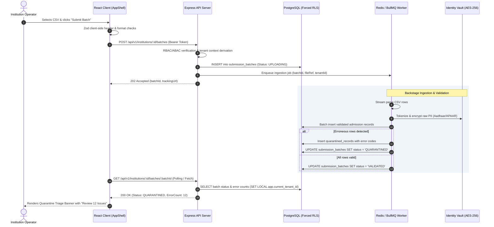

# AIRE — Service Blueprints

| Metadata     | Value                                        |
| ------------ | -------------------------------------------- |
| Document     | `docs/04-frontend/service-blueprints.md`     |
| Status       | `APPROVED`                                   |
| Reference    | UX4G Handbook Chapter 2 (Service Blueprints) |
| Last Updated | 3 November 2026                              |

---

## 1. Blueprint Overview

A service blueprint maps frontstage user interactions to backstage systems, databases, workers, and regulatory review steps.

---

## 2. Blueprint 1: Admission Batch Ingestion & Reconciliation Pipeline

---

## 3. Blueprint 2: Irreversible Cohort Sealing & Cryptographic Provenance

| Dimension                         | Operational Details                                                                                        |
| --------------------------------- | ---------------------------------------------------------------------------------------------------------- |
| **Physical / Digital Touchpoint** | Desktop / Laptop in Registrar Office, 2-Factor Authentication Device.                                      |
| **User Action (Frontstage)**      | Clicks "Seal Cohort" -> Reviews branch intake summary -> Enters password -> Confirms.                      |
| **Client Behavior**               | Disables submit button; renders full-screen blocking processing state; calls `/batches/:id/seal`.          |
| **Backstage (API Layer)**         | Re-checks session age (< 15 mins). Derives tenant context. Verifies no unresolved quarantined records.     |
| **Deterministic Rule Engine**     | Runs arithmetic intake verification (Approved Intake + Allowed Supernumerary >= Reported Admissions).      |
| **Database Transaction**          | Interactive PostgreSQL transaction: Updates batch status to `SEALED`, computes SHA-256 cohort Merkle root. |
| **Audit Ledger**                  | Inserts append-only record in `audit_events` with actor ID, timestamp, tenant ID, and state digest.        |
| **Feedback to User**              | Displays sealed certificate with non-repudiation digest and printable receipt.                             |

---

## 4. Failure Points and Recovery Matrix

| Failure Mode                                 | Layer              | Detection                                | User Recovery Experience                                                                              |
| -------------------------------------------- | ------------------ | ---------------------------------------- | ----------------------------------------------------------------------------------------------------- |
| CSV has corrupt encodings or binary data     | Client / Ingestion | Client-side file reader throws error     | Descriptive error: "File encoding must be UTF-8. Please re-save in Excel as CSV UTF-8."               |
| Network disconnects mid-upload               | Transport          | Axios timeout or network offline event   | Clear banner: "Upload interrupted. Connection restored — click Retry to resume." Batch is idempotent. |
| Database transaction deadlock / pool timeout | Persistence        | 503 Service Unavailable returned         | Toast with error code and auto-retry countdown; zero partial records saved.                           |
| Over-intake discovered during seal attempt   | Validation Engine  | 422 Unprocessable Entity with quota diff | Modal opens showing exact branch quota overflow (e.g., "Mechanical: 62 reported vs 60 approved").     |
