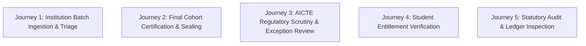

# AIRE — End-to-End User Journeys

| Metadata     | Value                                   |
| ------------ | --------------------------------------- |
| Document     | `docs/04-frontend/user-journeys.md`     |
| Status       | `APPROVED`                              |
| Reference    | UX4G Handbook Chapter 2 (User Journeys) |
| Last Updated | 3 November 2026                         |

---

## 1. Journey Overview

The following core user journeys define the essential end-to-end paths through the platform.

---

## 2. Journey 1: Institution Batch Ingestion & Triage (UJ-01)

- **Actor:** Admission Data Operator
- **Goal:** Ingest a branch admission batch, validate rows against intake limits, and resolve quarantine errors.

| Step            | User Action                                              | System Response                                                                      | Error / Edge State                             | Recovery Action                                                          |
| --------------- | -------------------------------------------------------- | ------------------------------------------------------------------------------------ | ---------------------------------------------- | ------------------------------------------------------------------------ |
| 1. Entry        | Clicks "Upload New Batch" from Submissions Ledger.       | Renders multi-step upload screen with format guidelines and quota status.            | User lacks `BATCH_UPLOAD` permission.          | 403 Forbidden alert with contact registrar prompt.                       |
| 2. File Select  | Selects CSV file or enters JSON payload.                 | Validates file extension, MIME type, and size (<10MB).                               | Unsupported file type.                         | Inline file error message with supported extensions (.csv, .xlsx).       |
| 3. Header Match | Reviews parsed column mapping.                           | Auto-maps headers (`Roll_No` -> `rollNumber`, etc.) and shows preview table.         | Unmapped mandatory field (e.g. `category`).    | Displays dropdown picker to manually bind CSV column to canonical field. |
| 4. Validation   | Submits batch for schema & arithmetic validation.        | Express pipeline processes batch; stores valid rows; routes errors to quarantine.    | 12 rows have invalid date or missing category. | Batch status set to `QUARANTINED`; shows link to Triage workbench.       |
| 5. Triage       | Navigates to Quarantine Triage view.                     | High-density table displaying erroneous rows with exact validation failure messages. | Operator unsure of correct category code.      | Tooltip with statutory category definitions (GEN, OBC-NCL, SC, ST, EWS). |
| 6. Correction   | Fixes row values inline and clicks "Re-validate & Save". | Updates record in database; recalculates batch clean percentage.                     | Field still fails validation.                  | Focus shifts to input with red highlight and descriptive error.          |
| 7. Resolution   | Resolves all quarantined records.                        | Batch status transitions to `VALIDATED`. Displays "Ready for Sealing" badge.         | Clean batch ready for Registrar review.        | Next step button links to Submissions Ledger.                            |

---

## 3. Journey 2: Cohort Certification & Sealing (UJ-02)

- **Actor:** Institution Registrar / Admin
- **Goal:** Irreversibly certify that the reported admissions represent the complete, final institutional cohort for the academic cycle.

| Step        | User Action                                                      | System Response                                                                          | Error / Edge State                        | Recovery Action                                                                |
| ----------- | ---------------------------------------------------------------- | ---------------------------------------------------------------------------------------- | ----------------------------------------- | ------------------------------------------------------------------------------ |
| 1. Review   | Opens Submissions Ledger; filters by `VALIDATED`.                | Shows branch breakdown, intake limit, filled seats, and category reservations.           | Intake exceeds approved limit by 2 seats. | Red warning banner highlighting over-intake violation; "Seal" button disabled. |
| 2. Initiate | Clicks "Seal Cohort".                                            | Opens modal warning: "This action is irreversible and locks admission records."          | Session idle > 15 minutes.                | Step-up re-authentication prompt required.                                     |
| 3. Confirm  | Enters password or confirmation token and clicks "Confirm Seal". | Generates cryptographic cohort hash, updates status to `SEALED`, writes to audit ledger. | Network drop during submission.           | Request is idempotent; retry prompt resumes without duplicate records.         |
| 4. Outcome  | Views confirmed sealed submission.                               | Renders immutable submission certificate with timestamp and transaction digest.          | None. Clean terminal state.               | Download receipt / return to dashboard.                                        |

---

## 4. Journey 3: AICTE Regulatory Scrutiny & Exception Review (UJ-03)

- **Actor:** AICTE Scrutiny Officer
- **Goal:** Review institutional admission discrepancies and issue Show Cause notices where violations occur.

| Step             | User Action                                                       | System Response                                                                        |
| ---------------- | ----------------------------------------------------------------- | -------------------------------------------------------------------------------------- |
| 1. Overview      | Accesses AICTE Overview workspace (`/aicte/overview`).            | Displays national summary cards: Total Sealed, Quota Variances, Pending Inquiries.     |
| 2. Filter        | Filters institution list by "Over-Intake" or "Category Mismatch". | Server-paginated table updates with matching institutions and variance severity.       |
| 3. Dossier       | Clicks an institution row to open reconciliation dossier.         | Side-by-side view: Statutory Approval vs Reported Admissions vs State Counseling Data. |
| 4. Inquiry       | Selects violation and clicks "Issue Show Cause Notice".           | Generates formal notice draft with statutory clause citation and 7-day hearing window. |
| 5. Dual Sign-off | Secondary officer signs off on notice issuance.                   | Notice dispatched to institution; logged in tamper-evident audit ledger.               |

---

## 5. Journey 4: Student Entitlement Verification (UJ-04)

- **Actor:** Enrolled Student
- **Goal:** Verify that seat admission is approved and download Admission Entitlement Proof (AEP).

| Step      | User Action                                             | System Response                                                                          |
| --------- | ------------------------------------------------------- | ---------------------------------------------------------------------------------------- |
| 1. Access | Visits Student Verification Portal (`/student/record`). | Clean, high-contrast, mobile-first lookup screen.                                        |
| 2. Query  | Enters Enrollment Number and Date of Birth.             | Validates format; queries pseudonymous entitlement index.                                |
| 3. Result | Views verified admission card.                          | Displays: Institution Name, Programme, Approval Cycle, Entitlement Token, and Masked ID. |
| 4. Export | Clicks "Download Proof".                                | Generates cryptographically verifiable PDF/SVG card with QR code.                        |
