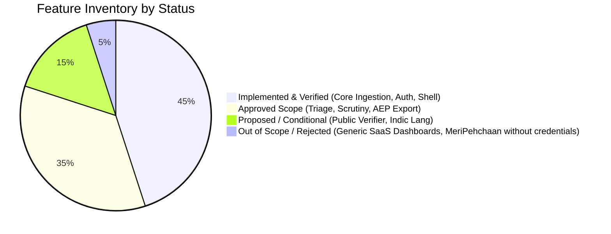

# AIRE — UX Scope and Content Inventory

| Metadata     | Value                                      |
| ------------ | ------------------------------------------ |
| Document     | `docs/04-frontend/ux-scope-and-content.md` |
| Status       | `APPROVED`                                 |
| Reference    | UX4G Handbook Chapter 1 & 2 (Scope Plane)  |
| Last Updated | 3 November 2026                            |

---

## 1. Feature Prioritization & Scope Boundaries

AIRE features are categorized strictly by regulatory necessity, operational impact, and authorization constraints.

---

## 2. Feature & Content Inventory

| Feature                             | Intended User                | Requirement Reference | Privacy Classification                    | Authorization Scope                | Priority | Implementation Status |
| ----------------------------------- | ---------------------------- | --------------------- | ----------------------------------------- | ---------------------------------- | -------- | --------------------- |
| **Standalone Public Login**         | All Users                    | `AIRE-REQ-001`        | Public form / Secret credentials          | Anonymous / Public                 | P0       | `VERIFIED`            |
| **Two-Tier Institutional Header**   | All Authenticated Users      | `AIRE-REQ-078`        | Public institutional text / Token context | Authenticated Session              | P0       | `IMPLEMENTED`         |
| **Tenant / Institution Switcher**   | Multi-institution Operators  | `AIRE-REQ-005`        | Institutional metadata                    | Verified Memberships only          | P0       | `VERIFIED`            |
| **Submissions Ledger & History**    | Institution Admin / Operator | `AIRE-REQ-012`        | Confidential institutional data           | `institution:read`                 | P0       | `VERIFIED`            |
| **Batch CSV/Excel Ingestion**       | Institution Operator         | `AIRE-REQ-015`        | Restricted Student PII                    | `institution:write`                | P0       | `VERIFIED`            |
| **Quarantine Triage Workbench**     | Institution Operator         | `AIRE-REQ-018`        | Restricted Student PII                    | `institution:write`                | P0       | `VERIFIED`            |
| **Cohort Sealing & Digital Digest** | Institution Registrar        | `AIRE-REQ-022`        | Statutory compliance record               | `institution:admin` + Step-up Auth | P0       | `IMPLEMENTED`         |
| **National Scrutiny Overview**      | AICTE Scrutiny Officer       | `AIRE-REQ-030`        | Confidential national regulatory data     | `aicte:read`                       | P1       | `IMPLEMENTED`         |
| **Exception Dossier Review**        | AICTE Scrutiny Officer       | `AIRE-REQ-034`        | Confidential regulatory evidence          | `aicte:write`                      | P1       | `APPROVED`            |
| **Student Entitlement Lookup**      | Enrolled Student             | `AIRE-REQ-040`        | Pseudonymous student record               | Public with DOB/Roll verification  | P1       | `IMPLEMENTED`         |
| **Immutable Audit Log Viewer**      | Statutory Auditor            | `AIRE-REQ-050`        | Tamper-evident ledger metadata            | `auditor:read`                     | P1       | `IMPLEMENTED`         |
| **Lightweight Public Verifier**     | Third-Party Verifier         | `AIRE-REQ-055`        | Zero PII / Cryptographic token            | Public Anonymous                   | P2       | `PROPOSED`            |

---

## 3. Conditional UX4G Recommendations: AIRE Contextual Evaluation

1. **Exploration without Login:**
   - _UX4G Recommendation:_ Allow users to explore government services before forcing registration.
   - _AIRE Application:_ Public information (AICTE Approval Process Handbook, policy pack rules, public degree verification terminal) is accessible without login. Student admission records, institution submission batches, and regulatory evidence remain strictly behind authentication and forced RLS.
2. **National Single Sign-On (MeriPehchaan):**
   - _UX4G Recommendation:_ Adopt MeriPehchaan SSO.
   - _AIRE Application:_ Evaluated under ADR-004. AIRE's core session management uses Better Auth. External SSO integration remains behind a decoupled boundary awaiting formal government credential provisioning. No fake SSO mockups are permitted.
3. **Personalization vs Data Minimization:**
   - _UX4G Recommendation:_ Personalize citizen portals based on demographic profile.
   - _AIRE Application:_ AIRE strictly avoids behavioural profiling. User preferences are limited to utility choices: interface language, text density, and accessibility settings.
4. **Offline Resilience:**
   - _UX4G Recommendation:_ Support offline data entry.
   - _AIRE Application:_ Local draft caching is permitted for unsubmitted quarantine edits in browser `sessionStorage`. However, **an offline batch is never represented as submitted** until confirmed by the server with a signed transaction hash.
5. **Analytics and Tracking:**
   - _UX4G Recommendation:_ Track user funnels.
   - _AIRE Application:_ Session replay tools (Hotjar, FullStory) and third-party advertising trackers are **strictly prohibited** on student and admission screens under DPDP Act 2023. Telemetry is restricted to server-side operational metrics (error rates, latency, batch duration).
