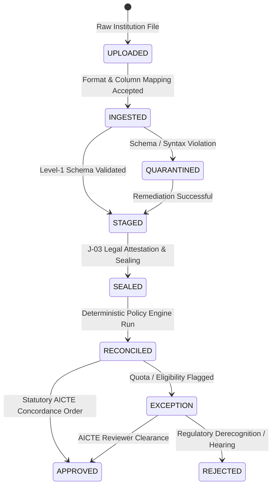

# AIRE Authoritative Domain Terminology & Capacity Calculations

**Status:** Approved Specification  
**Date:** 3 November 2026  
**Audience:** Product Engineering, Regulatory Analysts, UX Designers  
**Authority:** Derived from Approval Process Handbook (APH 2026–27), AICTE Act 1987, and AIRE Governance Specifications (`docs/04-domain/`).

---

## 1. Regulatory Context and Operational Purpose

AIRE is a **statutory admission reconciliation and evidence verification platform**, not an admissions portal or generic ERP system. Its core responsibility is to mathematically verify that technical educational institutions do not enroll candidates in excess of government-sanctioned intake caps or in violation of statutory quota reservations (General, OBC-NCL, SC, ST, EWS, and Supernumerary quotas like TFW, J&K PMSSS, and Lateral Entry).

Because institutional admissions carry severe legal implications (including derecognition or cancellation of excess student enrollment under AICTE Act §10.1), the user interface must employ **rigorous, unambiguous terminology**. Under no circumstances should technical staging metrics be portrayed as regulatory approvals.

---

## 2. Authoritative Domain Lexicon

### 2.1 Terminology Definitions

| Term | Exact Domain Definition | Data Source & Authority | Permitted UI Representation | Anti-Patterns (Forbidden UI Labels) |
| :--- | :--- | :--- | :--- | :--- |
| **Sanctioned Intake (Approved Intake)** | The legal maximum ceiling of students permitted to be enrolled in a specific programme for an academic cycle under the official AICTE Extension of Approval (EOA) order. | AICTE Extension of Approval (EOA) Order / Institutional Regulatory Profile. | `Sanctioned Intake (EOA)` `Approved Capacity: [N] Seats` | "Available Seats", "Target Intake", "Total College Capacity". |
| **Uploaded Records** | The raw line count detected in the client's uploaded file before mapping or validation. | File row counter (`lines.length - 1`). | `Raw File Rows` `Uploaded Lines: [N]` | "Admitted Students", "Enrolled Candidates", "Registered Students". |
| **Ingested Records** | The total records parsed into the processing queue following column header mapping. | `totalCount = stagedRecords + quarantineRecords` | `Ingested Records: [N]` `Total Records Processed` | "Valid Records", "Admitted Intake". |
| **Staged Candidates (Validated Records)** | Candidate records that strictly pass Level-1 syntactic and format validation (non-empty fields, valid date formats, valid APAAR ID format, standard reservation codes). Stored in staging ledger. | Staged Record collection (`validCount`). | `Staged Records` `Schema Validated: [N]` | "Approved Admissions", "Verified Students", "AICTE Endorsed". |
| **Quarantined Candidates** | Candidate records isolated due to syntactic defects, missing mandatory fields, invalid dates, unrecognized category codes, or duplicate identifiers. | Quarantine Record collection (`quarantineCount`). | `Quarantine Triage` `Discrepancies: [N]` | "Rejected Students", "Fraudulent Entries", "Illegal Admissions". |
| **Sealed Submissions (Submitted Cohort)** | A complete cohort batch with zero unresolved quarantine records that has been legally certified, password-attested by the Principal/Head of Institution (`INST_ADMIN`), and cryptographically sealed with a SHA-256 Merkle root. | Submission Batch with `status: "SEALED"`. | `Sealed Cohort` `Submission Locked` `Attested by Principal` | "Draft Submission", "Provisional Batch". |
| **Reconciled Records** | Records that have been evaluated by the deterministic Policy Engine (M10) against Section 10.1 approved quota caps, supernumerary allowances, and eligibility criteria. | Reconciliation Engine Output Ledger. | `Reconciled` `Quota Verified` | "Signed Off", "Staged". |
| **AICTE-Approved Records (Concorded Records)** | Individual candidate records that have cleared all automated checks and received formal statutory regulatory concordance from the AICTE Scrutiny Committee. | Official Concordance Order / Certificate. | `AICTE Approved` `Regulatory Concordance Active` | Do not apply to unsealed or merely staged records! |
| **Actual Admitted / Enrolled Students** | Students physically registered, enrolled, and paying tuition at the technical institution as certified by the Principal under statutory oath. | Institutional Legal Attestation (J-03). | `Declared Enrolled Students` | "File Count", "System Processed". |
| **Provisionally Reserved Capacity** | Capacity temporarily earmarked by candidate records currently sitting in staging prior to final sealing and reconciliation. | Sum of `stagedRecords` count across unsealed batches. | `Staged Capacity Utilization (Provisional)` | "Consumed Capacity", "Occupied Seats". |
| **Remaining Sanctioned Capacity** | The unallocated intake remaining under the official EOA ceiling before statutory freeze. | Derived calculation (see Section 3). | `Remaining Sanctioned Capacity` `Unallocated EOA Seats` | "Vacant Seats", "Open Admissions". |

---

## 3. Critical Evaluation of the Remaining Capacity Formula

### 3.1 Critique of the Naive Addendum Formula

In `UX-AUDIT-ADDENDUM.md`, the capacity formula was stated as:
$$\text{Remaining Capacity} = \text{Sanctioned Intake} - \text{Staged Validated Records}$$

**Regulatory Architecture Critique:**
This formulation is **technically flawed and dangerous** if presented as authoritative occupied capacity for three reasons:

1. **Staged Records are Neither Admitted Nor Approved:**
   A record that passes Level-1 schema checks (`stagedRecords`) has merely satisfied syntactic formatting (e.g. `2005-04-12` is a valid date and `OBC-NCL` is a valid code). The candidate has **not** been checked against state entrance rank lists, reservation entitlement certificates, supernumerary caps, or AICTE approval thresholds.
2. **Supernumerary Quotas Do Not Consume Sanctioned Intake:**
   Under AICTE regulations, certain categories (Tuition Fee Waiver / TFW, Jammu & Kashmir PMSSS, Lateral Entry, and PM Cares) are **supernumerary** (typically 5% to 10% *over and above* the sanctioned intake). Deducting a TFW student directly from the basic Sanctioned Intake reduces the reported General/All India seats incorrectly!
3. **Draft / Unsealed Batches Can Be Discarded:**
   Until the Principal executes the irreversible **J-03 Sealing Attestation**, batches can be deleted, re-uploaded, or substituted. Treating staged draft records as permanent deductions creates false capacity warnings.

### 3.2 Authoritative Multi-Tier Capacity Models

To preserve mathematical and regulatory integrity, AIRE establishes a **two-tier capacity model**:

#### Tier 1: Legal Capacity (Authoritative Institutional Ledger)
Applies strictly to sealed cohorts that have undergone Principal attestation:
$$\text{Legal Remaining Intake} = \text{Sanctioned EOA Intake} - \sum \text{Sealed Regular Admitted Candidates}$$

#### Tier 2: Provisional Operational Capacity (Ingestion Workbench)
Applies during drafting and triage:
$$\text{Provisional Available Intake} = \text{Sanctioned EOA Intake} - \left( \sum \text{Sealed Regular} + \sum \text{Staged Regular (Unsealed)} \right)$$

*Note on Supernumerary Sub-Ledger:*
Supernumerary quotas are tracked in an independent parallel ledger:
$$\text{Remaining Supernumerary Cap} = \text{Approved Supernumerary Cap} - \sum \text{Admitted Supernumerary Candidates}$$

---

## 4. Calculations Requiring Domain-Owner Approval

The following formulas and business policies must be formally signed off by the AICTE Regulatory Authority and Product Owner before being locked into production UI metric cards:

1. **Quarantine Row Quota Reservation:**
   * *Question:* When a candidate record is quarantined due to a date-of-birth or category typo, should their seat be temporarily held against the provisional capacity limit, or should provisional capacity ignore quarantined rows until remediated?
   * *Recommended Architecture:* **Hold provisionally with a 72-hour expiration window** before statutory cutoff to prevent over-enrollment while registrar corrects records.
2. **Supernumerary Cap Calculation (Over-and-Above):**
   * *Question:* Should TFW (5%) and Lateral Entry (10%) be displayed on a unified progress bar or in dedicated sub-gauges?
   * *Recommended Architecture:* **Dedicated Sub-Gauges** using `QuotaCategoryIndicator` to prevent confusing registrars on whether regular seats are exhausted.
3. **Unassigned Sanctioned Intake Fallback:**
   * *Question:* What must the UI display if an institution has not synced their annual EOA order from AICTE?
   * *Recommended Architecture:* Display `Intake Allocation: Pending Statutory EOA Sync` and **disable** the percentage progress bar; never default to an arbitrary number like `360`.

---
*End of DOMAIN-TERMINOLOGY.md.*
