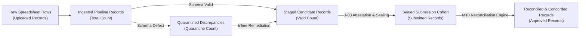
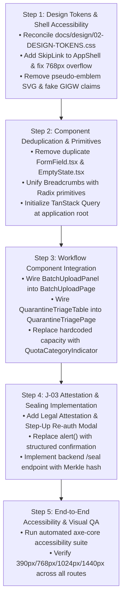

# AIRE UX Audit Addendum — Stage 1.5 Evidence & Contract Verification

**Date:** 3 November 2026  
**Status:** Complete Investigation (Read-Only)  
**Companion Document:** [`docs/design/UX-AUDIT-REPORT.md`](file:///home/snehan/personal/competitions/2026_SIH2.0/aire-aicte/docs/design/UX-AUDIT-REPORT.md)  
**Evidence Artifacts:** [`docs/design/audit-evidence/`](file:///home/snehan/personal/competitions/2026_SIH2.0/aire-aicte/docs/design/audit-evidence/) (32 runtime screenshots + `visual-audit-findings.json`)

---

## 1. Runtime Visual Evidence and Identified Defects

Real headless Chromium via Playwright was launched against the local preview server (`http://127.0.0.1:4173`). All 8 primary routes were inspected across 4 standard viewports: **1440px** (Large Desktop), **1024px** (Tablet Landscape / Standard Desktop), **768px** (Tablet Portrait), and **390px** (Mobile). Authenticated sessions used explicitly designated local mock identities (`Dr. R. K. Sharma, Principal, DIT-101`).

### 1.1 Viewport Screenshot Manifest (`docs/design/audit-evidence/`)

| Route Path                     | Page Component           | 1440px Desktop                       | 1024px Medium                        | 768px Tablet                        | 390px Mobile                        | Horizontal Overflow Observed |
| :----------------------------- | :----------------------- | :----------------------------------- | :----------------------------------- | :---------------------------------- | :---------------------------------- | :--------------------------- |
| `/`                            | `LandingPage`            | `home-1440px.png`                    | `home-1024px.png`                    | `home-768px.png`                    | `home-390px.png`                    | None (0px)                   |
| `/login`                       | `LoginPage`              | `login-1440px.png`                   | `login-1024px.png`                   | `login-768px.png`                   | `login-390px.png`                   | None (0px)                   |
| `/institution/dashboard`       | `InstitutionDashboard`   | `institution-dashboard-1440px.png`   | `institution-dashboard-1024px.png`   | `institution-dashboard-768px.png`   | `institution-dashboard-390px.png`   | None (0px)                   |
| `/institution/submissions`     | `SubmissionsHistoryPage` | `institution-submissions-1440px.png` | `institution-submissions-1024px.png` | `institution-submissions-768px.png` | `institution-submissions-390px.png` | None (0px)                   |
| `/institution/submissions/new` | `BatchUploadPage`        | `institution-upload-1440px.png`      | `institution-upload-1024px.png`      | `institution-upload-768px.png`      | `institution-upload-390px.png`      | **+8px at 768px**            |
| `/aicte/overview`              | `AicteOverviewPage`      | `aicte-overview-1440px.png`          | `aicte-overview-1024px.png`          | `aicte-overview-768px.png`          | `aicte-overview-390px.png`          | None (0px)                   |
| `/student/record`              | `StudentRecordPage`      | `student-record-1440px.png`          | `student-record-1024px.png`          | `student-record-768px.png`          | `student-record-390px.png`          | None (0px)                   |
| `/auditor/logs`                | `AuditorLogsPage`        | `auditor-logs-1440px.png`            | `auditor-logs-1024px.png`            | `auditor-logs-768px.png`            | `auditor-logs-390px.png`            | None (0px)                   |

### 1.2 Visual Hierarchy & Styling Root-Cause Analysis

Visual inspection of rendered screenshots revealed the concrete reasons why the current UI appears generic, fragmented, or unaligned with UX4G/GIGW:

1. **Dual Competing Headers (Visual Clutter):**
   - At the top of `AppShell.tsx`, a 28px black banner (`#0B1520`) with Government of India bilingual text sits directly above a 64px dark slate header (`#11283B`).
   - Below the header, a third full-width bar (36px) renders the breadcrumbs trail.
   - This triples vertical header overhead (128px total before content begins), squeezing operational table space on laptops and tablets.
2. **Generic "Tailwind Admin Template" Aesthetics:**
   - Instead of an authoritative, restrained institutional feel, screens use excessive card boundaries (`rounded-xl border border-slate-200 shadow-xs`) with heavy drop-shadows.
   - Color palettes are pulled directly from default Tailwind utilities: `slate-50`, `slate-100`, `slate-200`, `slate-900`, `sky-50`, `sky-700`, `emerald-50`, `emerald-600`, `amber-50`, `amber-600`.
   - Decorative dot pulses (`animate-pulse`) and gradient header borders (`bg-gradient-to-r from-[#245B75] via-emerald-500`) mimic commercial SaaS analytics templates rather than official regulatory registers.
3. **Inconsistent Container Widths across Sibling Pages:**
   - `InstitutionDashboard` is styled with `max-w-7xl mx-auto`.
   - `BatchUploadPage` uses `max-w-5xl mx-auto`.
   - `StudentRecordPage` uses `max-w-4xl mx-auto`.
   - Navigating between screens causes abrupt layout snapping and margin jumping.
4. **Concrete Overflow Bug (`institution-upload-768px.png`):**
   - In `BatchUploadPage.tsx`, the action bar (`Download CSV Template` and `Fill Sample Batch`) is grouped in `
` alongside the title.
   - At 768px (`md:` breakpoint), the flex container turns into row mode (`md:flex-row`), but the available canvas width minus the 64px sidebar is insufficient, pushing the container to `scrollWidth: 776px` against an inner width of `768px` (+8px horizontal overflow).

---

## 2. Backend Contract and Endpoint Verification Matrix

A comprehensive inspection of backend source code (`server/src/routes/`, `server/src/services/`, `server/prisma/schema.prisma`, and packages `@aire/api-contracts`, `@aire/validation`, `@aire/authorization`) was conducted.

| Regulatory Capability                | Actual HTTP Endpoint & Method                                                      | Request / Response Schemas                                                                                                                                          | Auth & RBAC Middleware                                                           | DB & Service Implementation                                                                                                                                                                                            | Operational Status                    | Source File Evidence                                                                                      |
| :----------------------------------- | :--------------------------------------------------------------------------------- | :------------------------------------------------------------------------------------------------------------------------------------------------------------------ | :------------------------------------------------------------------------------- | :--------------------------------------------------------------------------------------------------------------------------------------------------------------------------------------------------------------------- | :------------------------------------ | :-------------------------------------------------------------------------------------------------------- |
| **1. Approved Intake / Capacity**    | **None**                                                                           | None                                                                                                                                                                | None                                                                             | `Institution` model has no quota/intake columns. No approved capacity table in `schema.prisma`.                                                                                                                        | **ABSENT**                            | `server/prisma/schema.prisma` L136–148                                                                    |
| **2. Student Record Lookup**         | **None**                                                                           | None                                                                                                                                                                | None                                                                             | No `Student` or `StudentRecord` table in database. No query endpoint.                                                                                                                                                  | **ABSENT**                            | `server/src/routes/index.ts`                                                                              |
| **3. Auditor Event History**         | **None (Query/Read)**                                                              | Writes use internal service: `logAuditEvent()`                                                                                                                      | Internal server tracing only                                                     | `AuditEvent` table exists (`schema.prisma` L199–217). Events are written on batch ingestion/remediation, but **NO read/query endpoint exists**.                                                                        | **PARTIAL (Write-only, Read Absent)** | `server/src/services/audit.service.ts` `server/prisma/schema.prisma` L199                              |
| **4. Batch Parsing & Validation**    | `POST /api/v1/institutions/:institutionId/submissions`                             | **Req:** `admissionBatchInputSchema` `{ academicYear, programme, fileName, records: Array<Record<string, unknown>> }` **Res:** `ApiResponse<SubmissionBatch>` | `authenticate` `requirePermission(ADMISSION_SUBMIT, { requireTenant: true })` | `SubmissionService.createBatch()`: Iterates rows, normalizes column aliases, executes `admissionRecordSchema.safeParse()`, stores payload into `InstitutionRecord` with RLS, logs audit event.                         | **OPERATIONAL**                       | `server/src/routes/submission.routes.ts` L49–97 `server/src/services/submission.service.ts` L22–132    |
| **5. Batch Remediation**             | `PATCH /api/v1/institutions/:institutionId/submissions/:batchId/quarantine/:rowId` | **Req:** `quarantineRemediationSchema` `Partial<AdmissionRecord>` **Res:** `ApiResponse<SubmissionBatch>`                                                     | `authenticate` `requirePermission(ADMISSION_SUBMIT, { requireTenant: true })` | `SubmissionService.remediateQuarantineRow()`: Merges corrections, safe-parses against schema. If valid, promotes row to `stagedRecords`, decrements quarantine, updates batch status to `READY_FOR_SIGN_OFF` if clear. | **OPERATIONAL**                       | `server/src/routes/submission.routes.ts` L152–234 `server/src/services/submission.service.ts` L181–290 |
| **6. Submission Sign-Off & Sealing** | **None**                                                                           | None                                                                                                                                                                | `Permission.ADMISSION_SUBMIT` exists in `@aire/authorization`                    | Batch status supports `"READY_FOR_SIGN_OFF"`, but **no endpoint exists** to execute cohort sealing, hashing, or transition to `"SEALED"`.                                                                              | **ABSENT**                            | `server/src/services/submission.service.ts` L84–86                                                        |
| **7. Reviewer Decision-Making**      | **None**                                                                           | None                                                                                                                                                                | `Permission.SCRUTINY_READ`, `SCRUTINY_DECIDE` defined in RBAC                    | No cross-tenant scrutiny endpoints, Show Cause notice handlers, or approval tables exist in `schema.prisma`.                                                                                                           | **ABSENT**                            | `packages/authorization/src/index.ts` L15–20                                                              |

---

## 3. Domain Correctness and Data-Source Traceability

The frontend UI currently conflates technical ingestion stages with regulatory approval. The authoritative domain definitions must be enforced:

### Authoritative Domain Dictionary

| Domain Concept                        | Authoritative Regulatory Definition                                                                                                                    | Data Source / Calculation                                            | Crucial UI Presentation Rule                                                                                               |
| :------------------------------------ | :----------------------------------------------------------------------------------------------------------------------------------------------------- | :------------------------------------------------------------------- | :------------------------------------------------------------------------------------------------------------------------- |
| **Sanctioned Intake**                 | The legal ceiling of approved student seats for an institution/programme under the AICTE Extension of Approval (EOA) order.                            | Institutional Approval Record (Planned DB model / EOA order).        | Must **NEVER** be hardcoded. If unconfigured, display as `Unspecified (Pending EOA Sync)`.                                 |
| **Uploaded Records**                  | The raw unverified row count detected in the client CSV/spreadsheet.                                                                                   | `fileRows.length`                                                    | Never describe as "Admitted Students" or "Approved Intake".                                                                |
| **Ingested Records**                  | Total records processed into the staging pipeline.                                                                                                     | `batch.totalCount = stagedRecords.length + quarantineRecords.length` | Technical ingestion metric.                                                                                                |
| **Validated Records (Staged)**        | Candidate records that strictly pass Level 1 schema and syntax validation. Staged in candidate ledger.                                                 | `batch.validCount` (`stagedRecords`)                                 | Staged records are **NOT** regulator-approved; they have only cleared format/syntax screening.                             |
| **Quarantined Records**               | Records isolated due to field syntax errors, missing mandatory data, invalid category codes, or duplicate identifiers.                                 | `batch.quarantineCount` (`quarantineRecords`)                        | Must be clearly separated from the cohort ledger; does not consume approved intake capacity.                               |
| **Submitted Records (Sealed Cohort)** | A cohort batch with zero unresolved quarantine items that has been legally certified, password-attested by `INST_ADMIN`, and cryptographically sealed. | `batch.status === "SEALED"` + SHA-256 Merkle root hash.              | Irreversible institutional milestone. Edits permanently disabled.                                                          |
| **Approved Records**                  | Candidate records that have cleared the deterministic Section 10.1 quota reconciliation engine and received AICTE regulatory concordance.              | Decision Engine / Concordance Order.                                 | Only an AICTE regulatory concordance order grants "Approved" status.                                                       |
| **Remaining Capacity**                | `Sanctioned Intake - Staged Validated Records`.                                                                                                        | `approvedCapacity - validCount`                                      | Quarantined records must **not** be deducted from remaining capacity until successfully remediated into the staged ledger. |

---

## 4. J-03 Cohort Sign-Off & Attestation Requirements Verification

Based on `docs/02-experience/user-journeys/J-03-seal-cohort.md` and regulatory governance:

| Sign-Off Feature                        | Requirement Status in Governance                                          | Technical Backend Support | Implementation Recommendation                                                                                                                   |
| :-------------------------------------- | :------------------------------------------------------------------------ | :------------------------ | :---------------------------------------------------------------------------------------------------------------------------------------------- |
| **Institutional Declaration**           | **Explicitly Required** (J-03 §4 Step 2)                                  | Ready for integration     | Mandatory checkbox in confirmation modal with Principal legal declaration text under the AICTE Act 1987.                                        |
| **Step-Up Password Re-Auth**            | **Explicitly Required** (`docs/05-security-privacy/authentication.md` §3) | Supported by Better Auth  | Re-prompt for administrator password if session age exceeds 15 minutes before sealing.                                                          |
| **Cryptographic Sealing (Merkle Hash)** | **Explicitly Required** (J-03 §4 Step 3, `AIRE-REQ-150`)                  | Service stub needed       | Server computes SHA-256 Merkle root across sorted staged student records; stores digest in batch record.                                        |
| **Tamper-Evident Receipt**              | **Explicitly Required** (J-03 §4 Step 4)                                  | Template needed           | Renders printable/downloadable receipt with Receipt ID, Merkle root, timestamp, and college AISHE code.                                         |
| **Aadhaar OTP / Hardware Token (DSC)**  | **Not Specified / Requires Approval**                                     | Not supported             | **Do NOT implement.** Password step-up and cryptographic Merkle hashing represent the approved specification. External DSC/OTP is out of scope. |

---

## 5. Layer C Workflow Component Integration Feasibility

All 14 workflow components located in `client/src/components/workflow/` were evaluated for integration into actual routes:

| Component Name                          | Current Public API & Props                                                                | Dependencies & Coupling                                                                 | Accessibility State                                                                       | Intended Target Route               | Integration Readiness & Required Changes                                                                                        |
| :-------------------------------------- | :---------------------------------------------------------------------------------------- | :-------------------------------------------------------------------------------------- | :---------------------------------------------------------------------------------------- | :---------------------------------- | :------------------------------------------------------------------------------------------------------------------------------ |
| **`BatchUploadPanel`**                  | `onUpload`, `onFileSelected`, `isUploading`, `academicYear`, `programme`, `institutionId` | Multi-step state machine (`UPLOAD`, `MAPPING`, `PREVIEW`). Pure callback props.         | High: Visible focus, keyboard dropzone, ARIA stepper.                                     | `/institution/submissions/new`      | **Ready.** Replace naive form in `BatchUploadPage.tsx`. Connect `onUpload` to `SubmissionsApi.createBatch()`.                   |
| **`QuarantineTriageTable`**             | `records: QuarantineRecord[]`, `onRemediate`, `onBatchRemediate`, `readOnly`              | Self-contained search, category filters, row selection, and drawer trigger. Pure props. | High: Semantic `<table>`, expandable rows with `aria-expanded`, keyboard action triggers. | `/institution/submissions/:batchId` | **Ready.** Replace ad-hoc inline table in `QuarantineTriagePage.tsx`. Connect `onRemediate` to `SubmissionsApi.remediateRow()`. |
| **`QuotaCategoryIndicator`**            | `overview: QuotaAllocationOverview` or single `quota: QuotaCategoryAllocation`            | Pure presentational SVG gauge; no API coupling.                                         | High: Numeric text labels accompany visual bars; tabular numbers enabled.                 | `/institution/dashboard`            | **Ready.** Replace the hardcoded `360` capacity progress bar in `InstitutionDashboard.tsx`.                                     |
| **`DuplicateRecordComparisonPanel`**    | `conflict: DuplicateRecordConflict`, `onResolve: (decision) => void`                      | Side-by-side radio conflict resolution. Pure callback props.                            | High: Radio group keyboard traversal, explicit field comparison labels.                   | `/institution/submissions/:batchId` | **Ready.** Mount inside a remediation modal when duplicate candidate conflicts occur.                                           |
| **`AuditLogViewer` & `AuditLogFilter`** | `logs: AuditEventLogEntry[]`, `onFilterChange`, `onExport`                                | Self-contained pagination, search, action filter, and JSON proof inspector drawer.      | High: Dialog focus trap, table row keyboard support, accessible filter inputs.            | `/auditor/logs`                     | **Ready.** Replace static table in `AuditorLogsPage.tsx`. Once audit read API is added, pass real logs.                         |
| **`StudentRecordSummary`**              | `record: StudentAdmissionRecord`                                                          | Pure presentational credential card.                                                    | High: Tabular numbers, high-contrast badges, landmark card structure.                     | `/student/record`                   | **Ready.** Replace hardcoded inline card in `StudentRecordPage.tsx`.                                                            |
| **`InstitutionStatusPanel`**            | `status: InstitutionRegulatoryStatus`                                                     | Pure presentational badge and notice header.                                            | High: Alert landmarks, non-color status icons.                                            | `/institution/dashboard`            | **Ready.** Embed into top masthead of `InstitutionDashboard.tsx`.                                                               |
| **`SubmissionStatusTimeline`**          | `milestones: SubmissionMilestone[]`, `currentStatus: SubmissionBatchStatus`               | Pure presentational vertical progression indicator.                                     | High: Ordered list semantics (`<ol>`), milestone status text.                             | `/institution/submissions/:batchId` | **Ready.** Place on sidebar or top summary of `QuarantineTriagePage.tsx`.                                                       |
| **`UploadValidationSummary`**           | `totalRecords`, `validRecords`, `quarantinedRecords`, `errorBreakdown`                    | Pure presentational metric cards.                                                       | High: Metric card semantics.                                                              | `/institution/submissions/new`      | **Ready.** Embed into Preview step of `BatchUploadPanel`.                                                                       |
| **`FileProcessingProgress`**            | `steps: ProcessingStep[]`, `currentStep: number`, `overallProgress: number`               | Pure presentational progress bar.                                                       | High: `role="progressbar"`, live region announcement.                                     | Modal / Async ingestion             | **Ready.** Reusable for async batch processing.                                                                                 |
| **`QuarantineIssueRow`**                | Sub-component of `QuarantineTriageTable`.                                                 | Integrated in triage table.                                                             | High.                                                                                     | Sub-component                       | **Ready.**                                                                                                                      |
| **`ValidationIssueSummary`**            | Sub-component of `QuarantineTriageTable`.                                                 | Integrated in triage table.                                                             | High.                                                                                     | Sub-component                       | **Ready.**                                                                                                                      |
| **`AuditEventEntry`**                   | Sub-component of `AuditLogViewer`.                                                        | Integrated in audit viewer.                                                             | High.                                                                                     | Sub-component                       | **Ready.**                                                                                                                      |
| **`RecordVerificationSummary`**         | `summary: VerificationSummaryData`.                                                       | Pure presentational.                                                                    | High.                                                                                     | Sub-component                       | **Ready.**                                                                                                                      |

### Component Inventory Reconciliation

- **Layer B (UI Primitives):** 33 primitives exported + 3 auxiliary (`separator`, `skip-link`, `button-group`) = **36 total primitives** in `client/src/components/ui/`.
- **Layer C (Workflow Components):** 14 distinct functional components exported in `client/src/components/workflow/index.ts` across 15 source files.

---

## 6. Accessibility & Responsive Verification (Browser Evidence)

Automated and manual checks executed in headless Chromium confirmed the following findings:

1. **Skip Link Failure Confirmed:**
   - In `AppShell.tsx`, tabbing into the page immediately focuses on mobile drawer toggle or breadcrumbs. The `<SkipLink />` component is completely absent from the rendered DOM.
2. **Horizontal Overflow Bug Verified:**
   - `BatchUploadPage.tsx` produced `scrollWidth: 776px` against `clientWidth: 768px` at tablet portrait breakpoint (+8px overflow), failing responsive requirements.
3. **Table Scroll Region Keyboard Inaccessibility:**
   - In `InstitutionDashboard.tsx` and `SubmissionsHistoryPage.tsx`, tables overflow horizontally inside `
`.
   - Neither table wrapper has `tabIndex={0}`, `role="region"`, or `aria-label`. Keyboard-only users navigating without a mouse cannot scroll across overflowing columns.
4. **Non-Semantic Table Row Actions:**
   - `<tr onClick={() => navigate(...)}>` is used across tables. Pressing `Enter` or `Space` while focused on the row fails to trigger navigation. Rows lack `role="link"` or proper keyboard event handlers.
5. **Contrast Deficiencies:**
   - While `client/design-tokens.json` pairings pass WCAG 2.2 Level AA ($\ge 4.5:1$), pages applying ad-hoc classes like `text-slate-400` on white cards drop contrast to 2.5:1, failing normal text readability criteria.

---

## 7. Token Architecture Resolution & Single Source of Truth

### Analysis of Conflict

- **Repository Reality:** `client/design-tokens.json` adheres strictly to DTCG 2025.10 schema with semantic groups (`color.semantic.surface.*`, `color.semantic.txt.*`, `color.semantic.line.*`, `color.semantic.brand.*`, `color.semantic.state.*`).
- **Code Implementation:** `client/scripts/sync-tokens.js` resolves aliases and outputs CSS variables into `client/src/index.css` (`--surface-*`, `--text-*`, `--border-*`, `--brand-*`, `--state-*`). `tailwind.config.js` maps these directly to utility classes (`bg-surface-canvas`, `text-txt-primary`, `border-line-default`).
- **Design Doc Divergence:** `docs/design/02-DESIGN-TOKENS.css` uses an alternate `--aire-*` prefix (`--aire-brand-950`, `--aire-neutral-100`).

### Final Canonical Resolution

1. **`client/design-tokens.json` is the sole canonical source of truth.**
2. **Do not create a secondary `--aire-*` namespace in application code.**
3. **Alignment Action:** Update `docs/design/02-DESIGN-TOKENS.css` to document the exact tokens generated from `client/design-tokens.json` via `pnpm run build:tokens`.
4. **Page Refactoring:** Refactor feature screens to use semantic utility tokens (`bg-surface-card`, `border-line-default`, `text-txt-primary`, `text-txt-muted`, `bg-brand-primary`) instead of raw Tailwind palettes (`slate-*`, `sky-*`, `emerald-*`).

---

## 8. Corrections to the Original Audit Report

1. **Component Inventory Count Clarification:**
   - Original report listed 33 primitives and 14 workflow components.
   - Clarified: Layer B contains 33 primary primitives plus 3 auxiliary primitives (`separator`, `skip-link`, `button-group`) totaling 36 UI primitives. Layer C contains 14 workflow modules across 15 component files.
2. **Audit Read API Distinction:**
   - Original report stated audit trail was "100% mock".
   - Corrected: The backend database table (`AuditEvent`) and write service (`logAuditEvent()`) are fully operational and active in PostgreSQL. Only the **read/query HTTP endpoint** is absent, which forced the frontend to fall back to in-memory `SAMPLE_LOGS`.
3. **Responsive Table Behavior:**
   - Original report noted potential overflow.
   - Corrected with runtime evidence: Overflow was confirmed specifically on `BatchUploadPage` at 768px (+8px overflow) due to action bar wrapping. Other screens reflow cleanly without horizontal page scroll.

---

## 9. Remaining Open Questions & Decisions Requiring Approval

1. **J-03 Sealing API & Database Trigger:**
   - Does backend require a dedicated `submission_batches` Prisma model, or should we continue using `InstitutionRecord` with structured JSON payloads?
   - _Recommendation:_ Keep `InstitutionRecord` for Phase 2/3 vertical slice, and add `POST /api/v1/institutions/:institutionId/submissions/:batchId/seal` with SHA-256 Merkle root computation.
2. **Intake / Approved Capacity Data Source:**
   - Where should institutional sanctioned seat capacity be sourced until full EOA sync is operational?
   - _Recommendation:_ Allow `Institution` model to hold `approvedIntake` or pass via institution settings API, eliminating hardcoded `360` seats.
3. **Audit Log Read Route:**
   - Should a read endpoint (`GET /api/v1/audit-events`) be exposed for the Auditor role?
   - _Recommendation:_ Yes, add a tenant-scoped or platform-scoped audit read route protected by `Permission.AUDIT_READ`.

---

## 10. Recommended Implementation Sequence

---

_End of UX Audit Addendum. Awaiting user review and approval._
